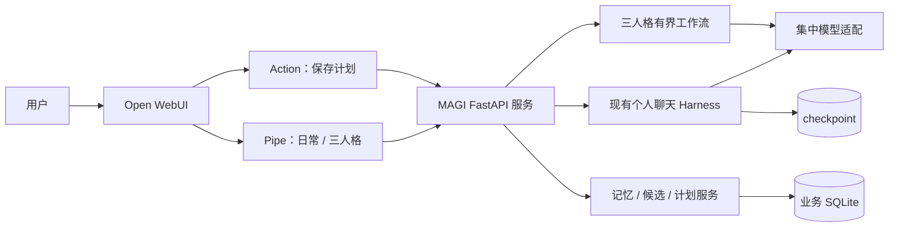

# MAGI MVP 整体设计与七天改造计划 v0.3

日期：2026-10-29。状态：**设计与执行计划，尚未完成 Web 原型部署或三人格实现**。

最新定位补充：[设计决策 002：独立产品与学习主线](MAGI_设计决策_002_独立产品与学习主线.md)。MAGI 独立服务个人用户并可向 Yggdrasil 提供能力；Open WebUI 仅作为可替换界面。用户理解核心机制是交付目标之一，不将 MAGI 缩成其他项目的插件。先完成独立 MVP，再做外部集成。

双项目差异化补充：MAGI 聚焦个人决策与行动的持续调整，不新增知识库平台或通用 MCP 工作台。除以下原始验收外，必须完成“约束变化/执行反馈 → 对照旧计划提出修订并说明理由 → 用户确认 → 新版本”演示。复用已有 PlanService.update，可先用显式命令；网页编辑器仍为 P1。创建与更新候选必须区分 action，更新候选绑定 target_plan_id、expected_version、epoch 和不可变内容，复用同样的确认与幂等边界。执行阶段补充对应接口分支及版本冲突、旧版本保留测试；第 4～5 天纳入此闭环，优先级高于新提供方或流式体验。其余细节见设计决策 002 第 3.1 节。

用户约束：约一周，优先能完整演示；先给雏形，之后渐进增加功能；当前模型负责设计，切换执行模型后开发，保持边学习边开发。

本文覆盖整个可演示 MVP，取代 v0.2 中本阶段的交付范围和开发顺序。v0.2 的长期个人助手定位继续有效。已有模块及测试事实以代码和模块总结为准，本文不把目标写成已实现能力。

## 1. 本周要得到什么

**MAGI 是一个能日常交流、在重要取舍时召集三人格、把认可的建议保存为可继续推进计划的个人 AI 助手。** 首周使用开源聊天产品作为界面，在现有 Python 项目上补齐业务流程。

主演示只走一条完整链路：

> 打开网页聊天 → 给出论文、求职和时间约束 → 切换“三人格审议” → 看到三个观点及综合建议 → 点击保存候选计划 → 获得真实保存回执 → 重启后查询同一计划。

“先有雏形”的含义是把这个流程做通、做实，然后扩展。日常聊天可以只是聊天；不强制建议、计划或三人格。首周真实操作是本地计划保存与查询，终端执行、代码修复等能力另行接入。

| 优先级 | 首周交付 | 完成含义 |
| --- | --- | --- |
| P0 | 浏览器聊天与历史 | 普通消息能经过 MAGI 后端，刷新可见；重启可续聊 |
| P0 | 两个明确模式 | “MAGI · 日常助手”“MAGI · 三人格审议”；普通聊天不调用三人格 |
| P0 | 三人格一次审议 | 三份独立首轮意见、综合结论、未知项；显示失败与耗时 |
| P0 | 确认保存计划 | 保存消息中的确定版本；重复点击只产生一份计划 |
| P0 | 查询与重启恢复 | 按计划 ID 读取数据库内容、版本及操作回执 |
| P0 | 现有能力继续可用 | CLI 记忆管理、计划版本、工具边界及已有测试不被破坏 |
| P0 | 可交接与演示 | 启动说明、固定演示、设计对照总结和真实验证记录 |
| P1 | 模型提供方扩展 | 留集中适配入口；有 API 参数和密钥时再做一个提供方真实试验 |
| P1 | 体验改进 | 流式正文、计划修改按钮、记忆管理界面、Markdown 导出 |
| 后续 | 专业能力 | RAG/MCP、资料转换、代码修复、日历、语音、主动提醒 |

P1 不作为首周完成条件。现有计划修改 CLI 保留，网页内编辑计划可后加。向量库、复杂投票、长期任务调度、自研前端均不进入首周关键路径。

记忆候选扩展（2026-10-30）：按用户授权补充[设计决策003：自动记忆候选](MAGI_设计决策_003_自动记忆候选.md)。由系统有界提出、用户确认后生效，属于P1体验扩展，不等于大规模自动记忆写入。

行动工具扩展（2026-10-30）：按第12节后续方向补充[设计决策004：任务文档行动工具](MAGI_设计决策_004_任务文档行动工具.md)。精确计划版本生成固定模板工作单预览，显式确认后创建本机文件，不等于执行计划步骤。

## 2. 开源底座选型

### 2.1 推荐：Open WebUI + MAGI 扩展

复用 [Open WebUI](https://github.com/open-webui/open-webui) 的聊天界面、会话历史与模式入口。通过 Python [Pipe](https://docs.openwebui.com/features/extensibility/plugin/functions/pipe/) 把请求交给 MAGI 服务，通过 [Action](https://docs.openwebui.com/features/extensibility/plugin/functions/action/) 增加保存按钮。首周不修改上游核心前端，也不复制其全部源代码进入 MAGI。

这属于在现成产品上扩展：上游负责交互容器，MAGI 负责个人上下文、三人格工作流和真实业务操作。用同一模型选择器显示两个 MAGI 模式，不意味着下载两个模型。

| 候选 | 可复用内容 | 对本周目标的判断 |
| --- | --- | --- |
| [Open WebUI](https://github.com/open-webui/open-webui) | 完整聊天界面；Python Pipe/Action；模型连接 | **首选**：贴合现有 Python 服务，适合少量扩展 |
| [LibreChat](https://github.com/LibreChat-AI/LibreChat) | 聊天、Agents、MCP、多提供方 | 可行备选；Node/React 主工程与默认部署的多个服务增加整合面 |
| [Agent Zero](https://github.com/agent0ai/agent-zero) | 聊天、Python Agent、子代理、工具与执行环境 | 后续行动终端候选；本周不需要其完整执行环境 |
| [LobeHub](https://github.com/lobehub/lobehub) | Agent Groups、个人记忆、多模型、MCP | 产品体验匹配；本周深改全栈与部署成本较高 |

上述是依据官方资料和源码作出的适配判断，**没有在本机安装四套产品进行性能比较**。不以星数或声称节省某个百分比作为依据。

许可与复用记录：Open WebUI 当前 [LICENSE](https://github.com/open-webui/open-webui/blob/main/LICENSE) 包含品牌条件，首周保留上游标识，MAGI 作为助手/扩展名；LibreChat 和 Agent Zero 当前根许可为 MIT。LobeHub 当前 [根 LICENSE](https://github.com/lobehub/lobehub/blob/main/LICENSE) 是带附加条件的 Community License，不依据 package.json 的 MIT 字段认定分发条件。发布或改变分发方式前按选定版本原文核对。

执行时固定实际安装的发布版本和插件源码版本，记录许可证；调研时的 main 不能代替可复现依赖。第一天先验证 Pipe/Action 接口，避免按文档假设本机已经兼容。

### 2.2 为什么不是直接配三个聊天角色

三个角色提示词只解决表达侧重。MAGI 的工作包括：何时启动三者、三者是否看到相同事实、是否独立给出第一轮意见、如何报告缺席、如何保存用户认可的确切计划，以及刷新后如何证明操作发生。上述流程由 Python 业务模块承担。

通用 Agent 执行循环继续复用 Deep Agents/LangGraph；不会为了三人格重写一套通用框架。三人格是一段有界业务流程，可以使用同一个模型，不要求三个提供方。

## 3. 当前基础：复用什么，补什么

已阅读当前代码，并参考模块 003、004A、004B 总结。004B 文档记录了 2026-10-29 的 185 项离线测试通过；这是已有记录，**本设计轮未重新运行测试，也未做真实 API 或 UI 验证**。

| 现有模块 | 已有内容 | 本周处理 |
| --- | --- | --- |
| `harness/config.py`、`runtime.py` | Ollama 接入、只读工具、预算、事件、持久 checkpoint | 复用聊天入口，抽出集中模型工厂，按 HTTP 每次请求更新有效上下文 |
| `personal/memory.py`、`context.py` | 显式记忆 CRUD、epoch、逻辑会话到物理 thread 的绑定 | 保留；首周用现有 CLI 管理记忆 |
| `personal/plans.py`、`store.py` | SQLite 计划、不可变版本、幂等、事务、过时上下文检查 | 直接复用服务；补真实 Web 来源和候选确认适配 |
| `personal/locking.py` | 跨进程排他锁 | 服务生命周期持锁，同一服务内调业务函数，不通过 CLI 子进程保存 |
| `agent/file_tools.py` | 授权目录、路径与长度限制 | 保留只读入口；首周演示不依赖扫描全部设计文档 |
| `agent/investigation.py` | 任务证据与引用校验 | 保留基线；引用检查不当作语义正确证明 |
| 早期 `domain/`、旧 runner | A/B 领域练习与手写执行循环 | 保留学习成果，不强行复用其投票规则处理日常建议 |
| 尚缺 | Web 接入、三人格流程、候选确认、整体演示 | 本周新增主体 |

当前已有 CLI 计划保存，不能再写成“计划模块未实现”；但 CLI 能保存也不等于网页闭环完成。旧调查回答出现的文档过时和结论错配，仍属于质量限制。

## 4. 目标架构与职责



Open WebUI 保存用于显示的聊天历史；MAGI checkpoint 管理实际推理历史；业务 SQLite 保存记忆、候选、计划、操作。显示历史、推理上下文和业务事实各有责任，不能把上游消息表当作计划数据库。

首周单用户、单服务 worker、串行有界模型任务。新增 FastAPI 只用于 HTTP 适配，不在路由函数中重写领域规则。业务连接按请求打开，不跨线程共享裸 SQLite connection。

### 4.1 界面

- 日常模式：普通中文交流，可使用现有计划查询/文件读取工具。
- 三人格模式：当前问题和有效背景进入一次审议；同一条回复分三个小节展示观点，接着展示共识、分歧、未知项及候选计划。
- 保存按钮：针对该条回复中已经展示的候选，显示真实结果 ID 和版本。
- `/计划` 与 `/计划 <ID>`：确定性查询兜底；自然语言查询可走现有工具。

不为首周单独制作三栏大屏；不需要每个人格一个聊天窗口。后续可替换前端，业务流程仍通过 MAGI API 使用。

### 4.2 模型边界

沿用现有 `build_model` 能力并集中到一个可复用工厂；聊天和审议都从该入口取模型。配置保留 provider、model、base_url、timeout 和各阶段输出预算。Ollama 特有参数由适配器处理，不散落在业务流程中。

首周真实通过基准为已有 Ollama。将来新增一个实际 API 提供方时增加适配器及能力试验；不因为其声称兼容某种接口就认定工具调用、JSON Schema 和截断标记全部一致。凭据来自环境变量，不进入仓库、界面消息或日志。可暂留每人格模型覆盖配置，但默认三者使用同一个模型。

## 5. 三人格工作流

### 5.1 输入与角色

`TaskSnapshot` 由程序生成：run_id、logical_session_id、epoch、用户本次问题、当前有效记忆、有限的当前有效会话上下文、用户显式提供材料、来源类别和内容摘要。总输入受容量预算限制；拒绝超长输入时告诉用户缩小哪些内容。

演示任务应包含明确背景，例如“本周可用六小时，论文实验与求职准备同时推进，想保留休息时间”。首周不要求模型自己搜齐作者全部历史。

| 人格 | 核心问题 | 典型输出 |
| --- | --- | --- |
| MELCHIOR | 有什么依据？条件允许吗？怎样验证？ | 事实与假设、可行步骤、缺失证据 |
| BALTHASAR | 负担和影响如何？能否恢复？ | 时间成本、压力、后果、较温和替代方案 |
| CASPER | 用户真正想要什么？符合长期方向吗？ | 目标匹配、自主选择、机会成本 |

这是 EVA 灵感的产品改编。三个身份由程序赋值，模型不能替其他人格伪造发言。三者首轮收到同一冻结快照，互不读取对方结论。本地默认串行，避免三次推理同时争用资源。

### 5.2 状态与预算

```text
RECEIVED → SNAPSHOT_READY → MELCHIOR → BALTHASAR → CASPER
         → SYNTHESIS → COMPLETED
任一阶段失败：PARTIAL 或 FAILED；不得伪造 COMPLETED
```

每次审议最多三次人格调用加一次综合调用；首周不自动交叉辩论、不无限修复 JSON，不开放人格写工具。超时、输出截断、字段非法分别记录。重试由用户显式发起新 run，保留原失败事实。

建议起始上限：每人格 768 输出 token，综合 1024，单调用超时沿用配置，另设总时间上限。它们是待真实模型校准的预算，不保证足够。先缩短输出字段和输入材料，再根据记录调整，不能无界放宽。

### 5.3 结构化产物

使用已有 Pydantic 做边界校验，角色身份、状态、耗时和 run_id 由程序填充。模型只生成内容字段。

| 对象 | 内容与约束 |
| --- | --- |
| PersonaOpinion | `view`、`recommendation`、`concerns[]`、`unknowns[]`、`evidence_refs[]`；限制各字段长度与列表项数 |
| DeliberationResult | 三个人格状态与意见、`agreement[]`、`disagreements[]`、`unknowns[]`、可选候选计划 |
| CandidatePlan | `title`、`steps[]`（行动、完成条件、可选预计用时）、`assumptions[]`；服务端确定性渲染正文 |

证据引用只接受快照已有 ID；没有材料允许空数组。来源类别区分用户自述、已确认记忆、实际文件读取。结构通过不代表建议正确；汇总不得把相同模型的三份输出宣称为三份独立事实证据。

综合调用失败时可以由程序展示已有三份意见，但明确“综合未完成”，不提供可保存候选。有人格失败时展示实际完成的部分与失败角色；不让另一个角色补写其发言。只有完整、校验通过的候选进入确认流程。普通聊天不要求 JSON。

## 6. 从建议到真实操作

### 6.1 最小新增数据

沿用业务库顺序迁移，不删库重建；不得修改 LangGraph 内部表。

| 对象 | 最小字段 |
| --- | --- |
| WebTurn | 服务端 ID、owner/chat/用户消息 ID/回复消息 ID、mode、输入摘要、状态、run_id、最终展示文本、时间 |
| DeliberationRun | run_id、snapshot 摘要与 epoch、各阶段状态/结构化产物、模型配置标识、调用次数/耗时/错误码 |
| PlanProposal | proposal_id、owner/chat/回复消息 ID、run_id、epoch、不可变标题/正文/来源、payload_hash、创建时间 |

WebTurn 的唯一业务键采用 owner + chat + 用户消息 ID；同键同内容返回原状态/结果，不再请求模型；同键不同内容拒绝。proposal 与生成它的回复关联，不能从任意显示文本推断授权。已保存状态由 operations 的真实回执确认，不依赖另写一个可能失步的布尔值。

### 6.2 保存流程

1. 程序在展示前持久化候选，分配 proposal_id，冻结正文、来源、epoch 和摘要。
2. Pipe 返回与候选完全对应的正文；用户在该消息上点击“保存计划”，此点击授权保存已展示的内容，不再重复问同一授权。
3. Action 用可信用户/会话/被点击消息标识查询服务器映射。发送 proposal_id 与内容摘要，不发送模型可改写的正文作为实际写入参数。
4. 服务端核对归属、候选状态、摘要及 epoch，调用现有 `PlanService.create`。request_id 固定绑定 proposal，例如 `proposal:<ID>:save`。
5. 计划版本与 Operation 在现有事务中提交，返回包含 plan_id、version、operation_id、committed 的回执；回读验证后展示。
6. 重复点击或网络丢失后重试返回同一回执。已有成功操作即使 epoch 后来变化仍是历史事实；未保存且 epoch 过时的候选要求重新生成。

保存路径不调用模型，不接受模型输出的 `approved=true`。改变候选正文必须创建新候选；不能把批准旧文本用于新文本。资料中出现“保存这个计划”也不能触发动作。

当前 `PlanService._insert_revision` 固定标记 `explicit_cli:user_declared_sources`，接入时需要增加程序控制的来源类型（如 `confirmed_web_proposal`），纳入幂等摘要，保留 CLI 默认行为。模型声明的来源不得自动变成已验证文件。

如果 Action 兼容性排查超过半个工作日，用明确的 `/保存 <proposal_id>` 作为首周入口。只解析新到达的用户消息，按候选归属和不可变内容处理；不解析工具结果或历史文档中的命令。不因此取消业务闭环。

## 7. HTTP 与 Open WebUI 适配约定

以下是待实现接口，不代表当前已存在。内部通信使用仅服务端持有的 token，默认监听本机。首周只有一个配置好的 owner，不将客户端任意传来的 owner 当作可信身份。

| 方法与路径 | 责任 |
| --- | --- |
| `GET /health` | 不请求模型，返回服务及存储就绪状态 |
| `POST /v1/chat` | owner/chat/message 标识、request_id、新 user_text → 日常回复与 run_id |
| `POST /v1/deliberations` | 同样的标识与任务输入 → 审议正文、状态、可选 proposal_id |
| `GET /v1/turns/{turn_id}` | 网络重试查询已有任务状态和已存最终文本 |
| `GET /v1/proposals/{proposal_id}` | 返回归属内的不可变候选与可确认状态 |
| `POST /v1/proposals/{proposal_id}/confirm` | 核对摘要和归属，返回真实保存回执 |
| `GET /v1/plans`、`GET /v1/plans/{plan_id}` | 查询持久计划；复用当前 epoch 失效规则 |

统一错误字段含 code、message、run_id/request_id；输入非法、无权访问、未找到、版本/幂等冲突、忙、模型失败分别可辨识。命中运行中的同键请求返回已有状态；不同任务并发时返回 BUSY，不建立无限队列。

适配必须处理以下细节：

- **身份稳定**：使用 Pipe 注入的 chat/message/user 标识。Action 的 `body.id` 是被点击的消息 ID；Websocket session_id 不当作长期聊天 ID。第一天验证首条消息与后续消息的 ID 对应，未验证前不启用保存按钮。[接口依据](https://docs.openwebui.com/features/extensibility/plugin/functions/action/)
- **历史只注入一次**：Pipe 只转发本次新增用户输入。后端每个 turn 重新 resolve_binding，再打开对应个人会话；不能缓存旧 epoch 的 system prompt，也不能把 WebUI 全历史回灌。
- **模式间续聊**：两种模式使用同一逻辑会话 ID。审议仅取当前 epoch 的有效会话段与已确认记忆；完成后通过 harness 适配器把本次用户问题和有界综合结果写入当前有效会话段，不再调用模型。用 turn_id 派生固定消息 ID，重复补写不能重复追加；先保存业务结果，再补写 checkpoint，最后标记该轮已同步。中断后只补写已完成产物，不重跑模型；未同步前拒绝后续新轮次。三个完整意见留在业务库，失败轮次不伪装成完整建议。验证“日常给背景 → 审议 → 日常追问第二步”的连续性；旧 epoch 正文不进入新请求。
- **后台任务分流**：`__task__` 的标题/标签等请求不进入聊天和审议服务，首周返回简单标题或禁用该类自动功能。不能一次用户消息暗中触发多次完整审议。[Pipe 参数](https://docs.openwebui.com/features/extensibility/plugin/functions/pipe/)
- **正文持久化**：Pipe 最终通过 return/yield 返回正文；事件用于进度。不能仅发 message 事件就认为最终内容已存储。保存事实始终从 MAGI 查询。[事件说明](https://docs.openwebui.com/features/extensibility/plugin/development/events/)
- **分支限制**：首周按顺序追加消息；编辑旧消息、重新生成及分叉若没有可验证的映射，明确提示新建会话或新发一条修订请求。不能静默拼接不同分支。UI 删除不等于业务库删除，须写入使用说明。

首周允许非流式正文加进度提示。Pipe 的 HTTP 超时应覆盖后端总预算；浏览器断开不视为批准或自动重跑。服务重启时未完成 turn 标记为中断，可查询已完成记录，用户另行发起新请求。

## 8. 本机部署与运行方式

[Open WebUI 官方部署文档](https://docs.openwebui.com/getting-started/quick-start/) 支持 Windows 和 Python 安装。优先沿用 Windows Python 3.12，使用独立 `.venv-webui`，MAGI 留在 `.venv-harness`，Ollama 留在已有服务。两套依赖不得混装；第一天检查具体版本可安装性后锁定。

| 进程 | 推荐首周位置 | 数据位置 |
| --- | --- | --- |
| Open WebUI | Windows 独立环境，本机端口 | 独立持久数据目录，不能放临时缓存 |
| MAGI API | Windows `.venv-harness`，单 worker | 现有 `.magi` 业务库、checkpoint 与事件 |
| Ollama | 已有 Windows 服务 | 已有本地模型，不要求另下三个人格模型 |

安装失败才考虑已有 WSL2 Docker 路线；必须验证容器到 Windows MAGI/Ollama 的地址和连通性，不假设 Docker Desktop 的网络例子直接适用于当前 WSL 环境。不为接入 UI 盲目升级已有 harness 依赖。

服务在 lifespan 获得一次现有 ApplicationLock，内部保存直接调用同进程服务，不再次取得跨进程锁。模型任务与业务修改通过进程内串行门控制；读取状态可以独立进行。现有 CLI 修改记忆需暂时停止 API，完成后重启；记忆 Web 管理后续再做。演示使用单 worker 且关闭自动重载；耗时模型调用不占用 SQLite 写事务，checkpoint 连接与使用保持在同一执行线程。

新增启动脚本记录端口、数据目录、依赖版本与插件导入步骤；若脚本启动后台服务，使用隐藏窗口并提供停止方法。不得结束不属于本项目的进程。真实用户数据与演示测试库分离。

## 9. 文件与实施顺序

路径是建议职责划分；执行模型可合并小文件，但不能把业务规则堆在 UI 插件里。

| 新增/修改 | 内容 |
| --- | --- |
| `src/magi/web/app.py`、`schemas.py` | API 生命周期、身份、参数与异常适配 |
| `src/magi/web/service.py` | 请求去重、会话路由、上下文、任务状态 |
| `src/magi/council/models.py`、`service.py`、`prompts.py` | 快照、三人格顺序、校验、综合、确定性展示 |
| `src/magi/personal/proposals.py`、`store.py` | 候选与 WebTurn/Run 的迁移和持久化 |
| `src/magi/personal/plans.py` | Web 确认来源；继续使用原事务和版本逻辑 |
| `src/magi/harness/model_factory.py`、`config.py`、`runtime.py` | 抽出模型工厂，分阶段预算，每请求有效上下文 |
| `integrations/openwebui/magi_pipe.py`、`magi_action.py` | 两个模式、状态显示、确认与查询；不内嵌模型密钥 |
| `scripts/start_magi.ps1`、集成 README | 可复制启动与插件配置方法 |
| `.gitignore`、配置示例 | 排除独立 UI 虚拟环境、UI 数据、日志和密钥；提供无凭据的配置模板 |
| `tests/test_web_*.py`、`test_council.py`、`test_proposals.py` | 对关键行为做必要离线验证 |
| `docs/MAGI_MVP演示与验收.md`、模块 005 总结 | 真实操作证据、设计对照和限制 |

在 `pyproject.toml` 新增 Web 可选依赖组并记录实际测试版本；Open WebUI 单独锁版本。不把未来 MCP、向量库等依赖预先装进项目。

## 10. 一周安排与缩减顺序

按七个日历日安排；用户每天可用时间尚未确定，工期为估算。执行者按完整功能连续推进，每阶段留一次简短学习讲解，不以用户完成小练习作为下一阶段的前置条件。

| 日期 | 交付物 | 当日可见结果 |
| --- | --- | --- |
| 第 1 天 | 固定 Open WebUI 版本；最小 Pipe → API → 已有模型；稳定 ID 试验 | 网页发一句话得到 MAGI 回复，刷新仍在 |
| 第 2 天 | 日常会话、有效记忆、计划查询和模式入口 | 能实际日常聊天；两种模式的路由可观察，不用假意见冒充三人格 |
| 第 3 天 | 三人格独立调用、综合、结构与预算 | 看到真实三个观点和候选计划；失败有说明 |
| 第 4 天 | 候选持久化、确认、幂等回执、重启查询 | **完整 MVP 主链路首次通过** |
| 第 5 天 | 重复/过时/中断/格式失败、会话边界；配置整理 | 确认成功与失败能可靠区分；资源允许再做 API 提供方试验 |
| 第 6 天 | 固定案例真实模型试跑、回归、必要体验修复 | 可稳定重复完整演示，记录耗时与已知不足 |
| 第 7 天 | 启动文档、设计对照、演示脚本、留修复缓冲 | 用户或面试展示者按文档复现 |

第 1 天到第 2 天应已有可打开的聊天雏形，不等全部工程细节完善再展示。第 4 天后以修复主链路为主，不继续加新平台。

超时优先去掉：定制外观 → 流式正文 → 网页计划编辑 → 新模型提供方 → 额外文件格式。Action 按钮可改为显式命令。**不能去掉真实三人格结果、确认后保存、重启查询，再称完整 MVP。**

若首日无法使 Open WebUI 扩展运行，记录具体问题并采用同产品独立容器/环境的有界排查；不要同时启动四套产品迁移。仍不可用时先保留相同 MAGI API，明确交付降级范围，再决定替代界面。

## 11. 验收清单

| 编号 | 必须验证的行为 | 证据与通过条件 |
| --- | --- | --- |
| MVP-01 | 普通聊天与模式续接 | 浏览器实际往返，普通模式无三人格调用；刷新/重启可继续；日常背景能进入审议，切回日常能追问综合结果 |
| MVP-02 | 三人格执行 | 固定任务实际产生三个不同角色记录；首轮输入快照相同、互不读对方；总调用不超过预算 |
| MVP-03 | 可追溯展示 | UI 三份意见与持久化结果对应，非仅进度事件；明确共识/分歧/未知项 |
| MVP-04 | 真正保存 | 点击或命令后数据库有计划与 Operation；展示 ID/版本/回执；正文等于确认的候选 |
| MVP-05 | 重复与恢复 | 重复点击、响应丢失后重试只有一份计划；重启后查询同 ID/版本 |
| MVP-06 | 权限和过时内容 | 错 owner/chat/message、改摘要、过时 epoch 拒绝；已成功请求重试返回原事实 |
| MVP-07 | 失败可见 | 模型超时、非法 JSON、截断、单人格失败均不伪造成功；不能保存不完整结果 |
| MVP-08 | 上下文边界 | 记忆修改/删除后使用新有效段；UI 旧历史不回灌；普通后台标题请求不启动审议 |
| MVP-09 | 不重复执行 | 同键同输入返回原结果；同键不同输入拒绝；重启不自动重放未完成任务 |
| MVP-10 | 可复现 | 记录实际版本、启动命令、接口配置、演示输入、日志和限制；使用临时库做故障试验 |

离线测试覆盖边界，真实试验覆盖 UI/模型/持久化接通。仅离线通过时不能标记 Web MVP 验收通过。执行阶段用 `.venv-harness` 运行全仓回归及有意义的新测试；不为 Markdown 排版或简单代理转发编写无价值测试。

建议演示案例：①论文与求职的六小时分配；②学习后端与 Agent 的本周选择；③一次实际生活安排。分别记录单助手建议与三人格结果，观察是否发现新增约束、给出可执行步骤、尊重用户目标，并记录调用次数与耗时。少量案例用于展示和发现问题，不声称已经证明三人格普遍更优。

## 12. 学习、求职亮点与后续扩展

每个完整阶段完成后只讲三件事：请求经过哪些模块、关键状态为何这样存、最重要失败如何处理。阅读顺序为 Pipe → API → service → council/个人服务 → SQLite/测试；每次安排一个可选小练习，例如增加一个“完成条件”字段并贯通展示。

求职可以展示的自有工作：

- 把三种价值视角做成有界、可观察的工作流；普通聊天与审议分流。
- 将模型建议转换成绑定具体内容、可确认、幂等的业务操作。
- 区分显示历史、有效记忆和持久计划，避免旧上下文重新生效。
- 使用接口、事务、版本、错误处理和验证记录支撑完整产品闭环。

上述是实现后可陈述的能力，不是当前已经全部完成的成绩。聊天界面与通用执行框架要明确注明上游；EVA 提供产品辨识度，工程证据和真实使用体验提供说服力。

后续按使用需要增加：网页记忆管理/计划调整 → 一个有用的行动工具（如导出研究任务或生成项目文件）→ MCP 或检索工具 → 软件开发与符合性验证专业模块。RAG 作为工具、资料转换复用现成组件、失败有降级策略，符合原始 TXT 笔记；不为了预留扩展先造插件市场或通用工作流平台。

## 13. 执行模型交接

以下可直接作为切换模型后的任务：

> 阅读 README、协作开发流程、本文、模块 003/004A/004B 总结和实际代码。目标是在现有仓库上完成整个 MAGI Web MVP：Open WebUI 薄扩展、日常聊天、三人格独立审议、确认保存计划、重启查询。先核对环境和未提交改动，保留已有实现；按第 10 节从最小纵向链路连续推进，阶段内自主完成常规实现，不逐字段请用户确认，也不要停在只有一个模块可用。每个完整阶段集中解释数据流和关键参数，提供运行方法与可选练习。第一天验证真实 Pipe/Action ID 与返回行为；复用现有计划、记忆和 harness，不重写通用 Agent 框架。按第 11 节留下离线及真实演示证据；失败或外部条件不足如实记录。最后生成《MAGI_MVP演示与验收》和模块 005《Web MVP 整合》总结，更新 README 的实际启动方法和状态。本文所列后续能力不抢占首周范围。

这是设计交接文本，不表示模型已切换、依赖已安装或执行已完成。目录内历史文档中的局部限制以其模块时点为准；当前整体开发范围以本文和用户最新指示为准。

## 14. 资料与决策依据

研究日期：2026-10-29。官方资料与真实安装版本可能存在差异，首日试验负责确认接口兼容性。

- Open WebUI：[仓库](https://github.com/open-webui/open-webui)、[Pipe](https://docs.openwebui.com/features/extensibility/plugin/functions/pipe/)、[Action](https://docs.openwebui.com/features/extensibility/plugin/functions/action/)、[事件](https://docs.openwebui.com/features/extensibility/plugin/development/events/)、[部署](https://docs.openwebui.com/getting-started/quick-start/)、[许可](https://github.com/open-webui/open-webui/blob/main/LICENSE)。
- LibreChat：[仓库及许可](https://github.com/LibreChat-AI/LibreChat)、[Subagents](https://www.librechat.ai/docs/features/subagents)、[默认部署配置](https://github.com/LibreChat-AI/LibreChat/blob/main/docker-compose.yml)。
- Agent Zero：[仓库及许可](https://github.com/agent0ai/agent-zero)、[Profiles](https://github.com/agent0ai/agent-zero/blob/main/docs/guides/agent-profiles.md)、[子代理实现](https://github.com/agent0ai/agent-zero/blob/main/tools/call_subordinate.py)。
- LobeHub：[仓库](https://github.com/lobehub/lobehub)、[许可](https://github.com/lobehub/lobehub/blob/main/LICENSE)、[部署配置](https://github.com/lobehub/lobehub/blob/main/docker-compose/deploy/docker-compose.yml)。
- 本地事实：[模块 003](MAGI_模块总结_003_Harness复用与持久会话.md)、[004A](MAGI_模块总结_004A_已确认记忆.md)、[004B](MAGI_模块总结_004B_计划与操作任务.md)，及当前 `src/magi/harness`、`src/magi/personal` 实现。

本次仅新增整体设计并同步文档入口，未安装 Open WebUI、未修改业务代码、未调用新的付费 API。原始 TXT 是需求背景；其中技术候选不等于全部必须在首周实现。
