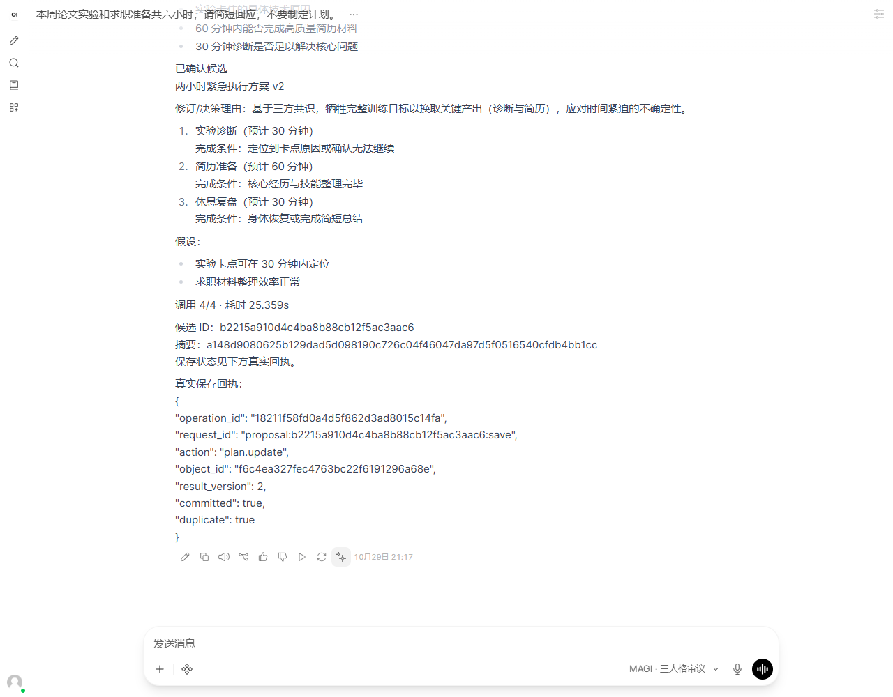
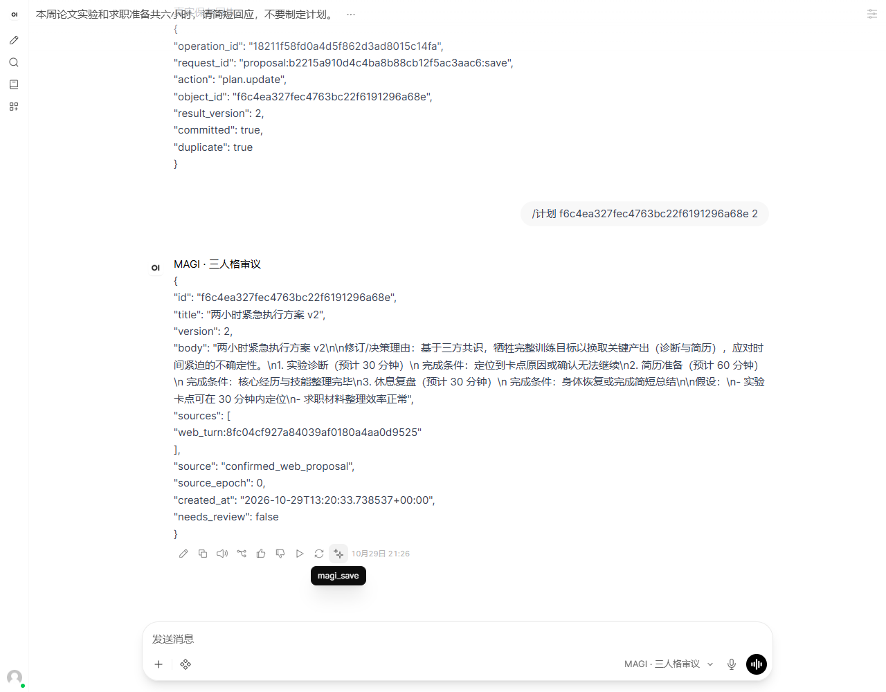

# MAGI MVP 演示与验收

日期：2026-10-29（Asia/Shanghai）。范围：单用户、本机、单 worker。结论：已经实际走通网页聊天、三人格、确认保存、重复确认、API 进程重启查询、反馈修订 v2 与旧版本查询；**模型输出稳定性尚不足以承诺每次自动演示成功**。PARTIAL 会保留失败事实，不产生可保存候选。

## 环境与离线验证

- Windows Python 3.12.3；原有 Deep Agents 0.7.32 / LangGraph 1.2.18 / langchain-ollama 1.1.0。
- MAGI：FastAPI 0.121.0 / Uvicorn 0.38.0 / Starlette 0.49.3 / httpx 0.28.1；独立 `.venv-harness`。
- Open WebUI 0.12.5，独立 `.venv-webui`，依赖解析锁定于 `requirements-webui.lock.txt`；未更改其源码或品牌。
- 浏览器：Playwright 1.56.0 控制本机 Edge，真实浏览器页面与本机 HTTP；新下载 Chromium 启动失败后使用 Edge。Playwright 仅为开发验收工具，不是业务运行依赖。
- Ollama：本机 `qwen3.5:4b`，不是模拟模型。新界面环境没有下载新模型；其离线 embedding 不可用，不参与本次聊天。

原基线：185 passed in 8.99s。加入 Web MVP 与边界后完整回归：**204 passed in 11.03s**（19 个新增测试实例）；一个上游 TestClient/AnyIO 的弃用警告。两个虚拟环境 `pip check` 均为 No broken requirements found。

运行命令：

```powershell
.\.venv-harness\Scripts\python.exe -m pytest -q
.\.venv-harness\Scripts\python.exe -X utf8 scripts/demo_mvp.py
```

当前受限 Windows 沙箱内 asyncio 创建内部 socketpair 会挂起；通过故障栈定位后，在允许本机套接字的执行环境运行 HTTP 测试通过，不通过跳过测试掩盖。修改文件的 Ruff 检查与格式化通过。全仓 Ruff 另有 14 个既有练习文件的导入/风格问题，本轮保留已有修改，没有批量重写这些文件。

## 真实浏览器链路

完整数据证据：[`validation/005-webui-evidence.json`](validation/005-webui-evidence.json)。只包含固定演示的业务数据，无 API token、登录密码或浏览器授权信息。

1. 在 Open WebUI 选“MAGI · 日常助手”，发送六小时论文/求职背景。实际返回正文；刷新后仍存在。MAGI 库只有一次日常 turn，没有三人格 run。首条 chat/user/reply ID 已与上游实际消息核对。
2. 切到三人格模式，发送带 `/预算 360` 的任务。首个宽泛任务得到 PARTIAL；随后显式新发具体任务，保留首轮失败，不自动重跑。成功轮三个角色耗时 4.562 / 4.094 / 4.234 秒，总审议 22.968 秒，调用 4/4。网页完整显示三份意见、共识、分歧、未知项与确定性候选。
3. 点击成功回复的保存按钮：得到计划 **`f6c4ea327fec4763bc22f6191296a68e` v1**；Operation **`ede630bfc54d4924aa8be6fcb51655c5`**。重复点击回同一 Operation，duplicate=true，库中仅一份计划；刷新仍显示回执。
4. 停止并重新启动本轮 API 进程，使用相同隔离数据库；网页新发 `/计划 <ID>`，回读相同 v1 正文、来源和版本。不是仅在同一对象上“模拟重启”。
5. 网页发送 `/预算 120 /修订 <ID> 1 ...`：实验卡住，仅剩两小时；将实验诊断、简历与休息缩为 30/60/30 分钟。三人格耗时 5.219 / 5.687 / 5.766 秒（以原始 JSON 为准），总审议 **25.359 秒，4/4 调用**。候选正文明确放弃完整训练目标，保留诊断和简历产出。
6. 一次保存与另一演示任务并发，返回 BUSY，未冒充提交；空闲后显式重试成功更新同一计划为 **v2**，Operation **`18211f58fd0a4d5f862d3ad8015c14fa`**。再次点击没有 v3。查询 v1、v2 均存在，旧文未覆盖。最终插件还验证了服务端消息树与正常顺序查询兼容。

v1 三步为 180/120/60 分钟，v2 为 30/60/30；修订理由作为 revision 正文持久保存。最终截图：





另在 API 自带的简易页实际发送消息、刷新、重新填凭据并加载历史成功。其凭据只留当前页面内存；截图 [`005-native-chat.png`](validation/005-native-chat.png)。最初自我介绍过度偏向资料管理，已纠正共用 system prompt 的产品定位，不能将旧介绍当作当前产品范围。

## 验收对照

| 编号 | 本轮证据与边界 |
| --- | --- |
| MVP-01 | 真实网页普通往返与刷新通过；日常背景进入快照；API 真实模型曾通过审议后日常追问第一步。长会话仍受容量上限约束。 |
| MVP-02 | 三份真实角色记录，同一冻结输入；离线核对首轮 payload 完全一致；最多 4 次调用。 |
| MVP-03 | 三份意见和综合实际存在于上游正文及业务 JSON；不是只发进度事件。 |
| MVP-04 | 真实按钮写入计划/revision/Operation；保存后回读核对正文与候选。 |
| MVP-05 | 真实重复点击只一份计划；API 进程重启后网页查询同一 ID；更新旧版仍存在。 |
| MVP-06 | 离线错 owner/chat/reply/hash、旧 epoch、版本冲突拒绝；已提交后 epoch 改变仍可回原回执。 |
| MVP-07 | 真实 PARTIAL 与 BUSY 展示；离线非法 JSON、单人格失败、未知引用、超预算和中断无可保存候选。截断检查复用 harness，错误码区分。 |
| MVP-08 | 既有记忆 epoch 回归保留；新测试不把旧 epoch 待同步内容写回新段；后台任务在 Pipe 提前分流。 |
| MVP-09 | 同键同输入不调用模型；输入变更拒绝；中断保留已完成人格，不自动重跑。旧父回复拒绝；上游树校验已实际正常查询验证。 |
| MVP-10 | 依赖锁、启动脚本、插件源码、演示脚本、结构化证据、截图和本记录齐全；多案例稳定性仍待提升。 |

## 发现的问题、修复与未完成项

已修复：完整人格文本同步 checkpoint 导致很快超容量，改为只同步有界综合候选；Windows 读连接未关闭导致临时库清理失败，新增显式关闭；模型把两小时排成超预算，增加用户显式分钟预算和程序求和校验；保存成功后旧“尚未保存”文案与上游旧错误残留，Action 返回规范正文及清空 error；旧消息分叉可能混入最新上下文，新增父回复和上游树校验。

真实复跑仍发生人格引用/长度校验失败与综合截断。按计划先缩短输出字段、限定引用 ID，再将综合输出上限从 1024 校准为 **1536 token**；人格仍为 768，调用总数与时间上限不变，无自动修复循环。每次脚本证据独立留在 `.magi/demo-evidence-<UTC时间>.json`，失败不覆盖旧 run，也不以测试通过冒充模型稳定。启动脚本与界面允许用户显式新发更具体请求。

仍未实现：自动从自然语言可靠抽取硬性时间预算、长历史摘要、流式正文、网页自由编辑、记忆 UI、第二提供方、Yggdrasil 集成。完整故障覆盖不等于建议语义正确；目前只完成论文/求职主演示，没有完成三个场景的系统性效果比较，也不声称三人格普遍优于单助手。任意缺省预算或假设仍需用户审阅。

## 用户复现

从 README 的 Web MVP 启动节开始；首选完整配置见 [`integrations/openwebui/README.md`](../integrations/openwebui/README.md)。API 演示与故障试验使用独立临时数据，现有 `.magi` 个人数据未清空。API 与 CLI 共享锁，修改记忆前先停服务。测试数据目录不代表正式个人数据；上游删除聊天不会删除 MAGI 业务事实。

本记录证明一次真实完整产品链路及必要失败边界，保留模型稳定性与效果评估的未通过部分，作为继续迭代依据。
