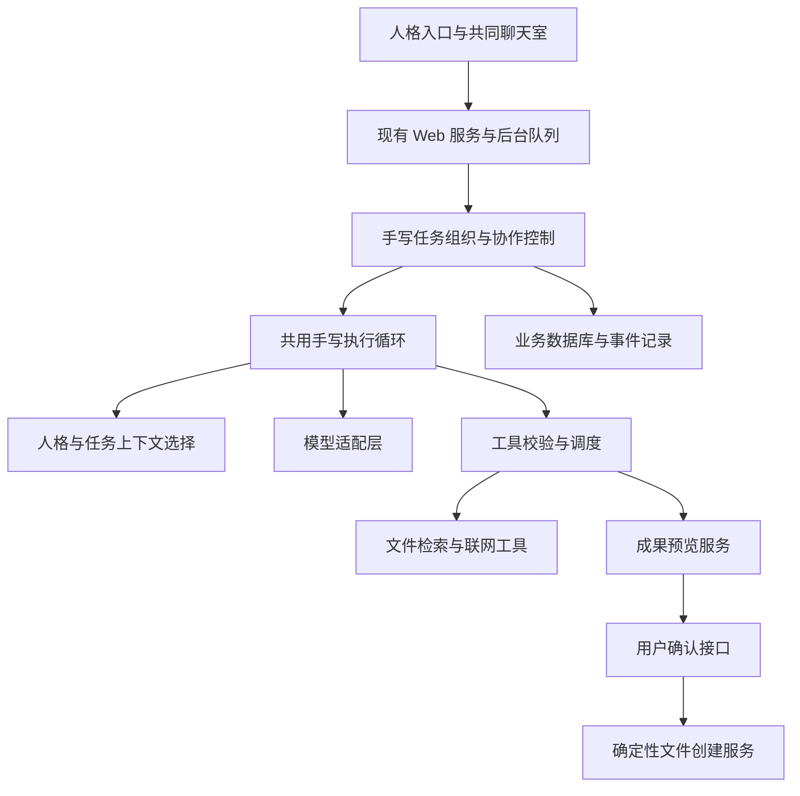

# MAGI 个人研究与行动助手设计 v0.4

日期：2026-11-03。状态：开发定稿。本文规定第一阶段实现与验收契约，新增能力待开发。本次定稿包含上下文装配、独立评估、一次改进和最终复核。

本文承接[当前版本整体验收](MAGI_模块总结_044_当前版本整体验收.md)。用户已确定产品方向、原作三人格、双入口和核心手写原则。本文中的流程、接口语义和验收条件作为第一阶段契约，类名与表名允许按现有代码调整。预算数值属于可配置初值，调整须保留评测依据。执行模型收到开始开发指令后，按第12节连续交付完整功能。

## 1. 产品要解决什么问题

MAGI 将从已经走通计划保存与执行反馈的个人助手，发展为具有 EVA 三人格的个人研究与行动助手。用户交办一个目标后，任意人格都能在允许的工具范围内调查资料、处理结果、交付成果；有必要时，其他人格参与检查或权衡。用户既可以单独找一个人格，也可以进入共同聊天室。

最重要的产品变化，是从“给我建议如何做”走到“在授权范围内替我完成，并提供可检查的成果”。人格影响判断和交流，不用于限制基本能力。三者都应能读资料、联网调查、形成报告和准备操作，不能把某个人格做成只能安慰或投票的附属角色。

首批真实任务选择“结合个人背景的调查与成果交付”。技术选型、论文比较、项目调查、求职材料和个人资料整理都属于这个入口。求职是示例，不是强制领域标签。MAGI 不扩展为企业知识库平台，也不以重新建设通用检索产品为本阶段目标。

### 1.1 已确定与建议默认值

| 项目 | 状态与含义 |
| --- | --- |
| 三人格贴合 EVA 原作 | 用户已确定；具体日常语言风格仍需体验调整 |
| 独立入口和共同聊天室 | 用户已确定；支持选择人格，聊天室允许指定参与者 |
| 独立完成任务优先 | 用户已确定；行动能力优先于头像、语音和长篇角色表演 |
| Agent 核心手写 | 用户已确定；模型循环、上下文策略、工具调度、重试、运行状态和协作由项目掌握 |
| 外围复用成熟组件 | 用户已确定；不自研数据库引擎、HTTP 客户端、浏览器驱动或文档解析器 |
| 第一批任务为研究与文档交付 | 根据已接受的方向提出的实施范围；不限定为某一行业 |
| 本机单用户、单 worker | 本阶段默认沿用；多 Agent 是多个独立运行对象，不等于多进程或多租户 |
| 首轮串行协作 | 实施默认；独立上下文，最多两次评估和一次修改，具体出口见第5.1节 |

此前文档中“核心流程优先交给完整 Agent 框架”的建议，在与本轮核心手写要求冲突时，以用户本轮要求为准。其他已验收的数据边界继续保留。本文不覆盖历史事实，也不宣称旧版所有入口都已经手写。

## 2. 当前代码基础：哪些需要扩展，哪些不重做

第044轮记录了 472 项回归通过及真实主链、重启和备份恢复证据。这是历史验收结果，本轮没有重新执行这些测试。该轮同时发现人格建议相似、修订没有充分利用“已整理日志”的反馈，说明数据闭环通过不代表协作产生额外价值。

| 当前入口或模块 | 本轮查阅的真实基础 | 后续处理 |
| --- | --- | --- |
| `harness/chat_loop.py` 的 `ChatLoop` | 网页循环自己调用模型、检查工具批次、执行工具并继续生成 | 提炼为三人格共用执行引擎，不另写三套循环 |
| `web/chat_history.py` 的 `WebChatHistory` | 网页历史已接入业务存储 | 增加人格和任务上下文隔离，保留完整消息 |
| `web/service.py` 的 `WebService.turn` | 装配会话，校验请求，保存轮次与历史 | 接入人格选择和执行结果，不移除现有重试去重 |
| `web/tasks.py` 的 `AgentTasks` | 持久队列、领取、轮次关联和保守恢复 | 复用后台执行入口，增加参与者和运行关联 |
| `council/service.py` 的 `Council.run` | 三角色意见和综合候选流程 | 保留旧计划兼容；新协作应调用可行动的人格运行，而不只生成三段意见 |
| `personal` 中记忆、计划、执行记录 | 已有确认、版本和业务回执 | 作为现有业务服务使用，不把研究报告强行保存成计划 |
| `personal/approvals.py` | 旧工作单审批使用 LangGraph 暂停与恢复 | 作为明确标注的旧兼容路径保留；新研究成果审批采用自有状态控制 |
| 终端及旧 harness 路径 | 仍存在 `create_deep_agent` 和旧 checkpoint 使用 | 首轮不迁移；不得因此声称全仓库核心均已脱离框架 |

一个已有机制值得保留：先检查整批工具请求，再执行其中任何一个工具。以下摘自当前 `ChatLoop.validate_batch`，不是拟议代码：

```python
for call in calls:
    if call["name"] not in self.tools:
        raise PermissionError("模型请求了本轮未开放的工具")
    if not call["id"] or call["id"] in seen:
        raise ValueError("同批工具请求必须有唯一调用 ID")
    seen.add(call["id"])
    schema = self.tools[call["name"]].get_input_schema()
    if isinstance(schema, type) and issubclass(schema, BaseModel):
        schema.model_validate(call["args"])
```

工具白名单来自程序注册，调用 ID 和参数来自模型。程序拒绝越权工具、重复 ID 和不合法参数，避免一批请求中后面的明显错误被发现之前，前面已经产生副作用。这个检查不等于事务回滚：工具实际执行后失败，先前已提交的业务结果仍然可能存在。

模块036曾描述依赖旧 checkpoint 的网页历史；模块040以后的业务历史不能按这个旧状态理解。实施者应以当前代码和最新总结为准。

## 3. 原作人格与产品补充必须分开

人格基础采用赤木直子的三种自我：MELCHIOR 对应科学家，BALTHASAR 对应母亲，CASPER 对应女人。原作基础与下面为产品补充的行为设计分开记录，不能把“温柔”“战略规划”等提示词称为原作明确规定。

本轮参考了[第13集公开转录](https://www.animanga.com/scripts/textesgb/eva13.html)和[人物资料页](https://evangelion.fandom.com/wiki/Naoko_Akagi)，访问日期为 2026-11-03。这些是第三方资料，不是官方设定审定；后续提示词只以三种身份为基础，不凭二手解释虚构详细原作台词或人格规则。

| 人格 | 本产品建议的判断侧重 | 同一研究任务中的表现 |
| --- | --- | --- |
| MELCHIOR | 证据、因果、可验证性 | 检查资料是否支持结论，区分实测与推测 |
| BALTHASAR | 照护、责任、实际负担 | 检查维护成本、用户精力和失败后的影响 |
| CASPER | 个人意愿、情感立场、自我选择 | 追问用户是否真的需要这个方案，保留与主流选择不同的偏好 |

上述侧重是产品改编，不把“女人”解释为不理性，也不把“母亲”限定为只会安慰。人格不能为了保持角色而编造事实、隐藏风险或绕过授权。三者可以得出一致结论，不强行制造冲突；同样不能为表现一致而抹去真实分歧。

人格定义使用稳定 `agent_id` 和带版本的配置。展示名、提示词和风格可调整；已有运行保留当时配置版本和摘要，避免修改人格后无法解释旧结果。第一阶段只支持三个内置人格，不做角色市场或模型自动改写人格。

## 4. 贯穿设计的真实场景

用户在 MELCHIOR 的独立入口发出请求：

> 阅读我提供的 MAGI 项目说明，调查三种适合本机单用户项目的记忆方案。说明哪些能力项目已有、哪些需要新增，交付带来源的比较报告。可以联网；不安装依赖，不修改项目代码。

提交后，页面立即显示任务和负责人。程序保存输入、允许的资料范围、联网开关、人格版本及当前背景版本，然后后台执行。模型阅读项目说明，决定查哪些公开资料。每次工具请求先由程序校验；网页和文件正文只是材料，不能变成更高优先级的执行指令。

MELCHIOR 根据实际工具结果继续调查。如果某个成本或兼容性结论缺乏资料，可以补查，也可以在预算耗尽时明确列出未知项。报告包括结论、对比、来源、现有项目对应点和未核实事项。引用格式与来源身份由程序检查，结论是否获得来源支持仍需模型复核和人工验收。

生成结束时，后端保存可恢复的报告草稿。用户看到的是“报告草稿已生成”，不是“方案已实施”。若用户点击“批准保存为文件”，程序绑定预览内容创建 Markdown 成果，并返回实际路径和状态。文件创建成功也不代表记忆方案已经接入项目。

用户随后在共同聊天室说“请另外两个人格检查维护负担和个人适用性”。共享的是这份报告、任务约束和明确选入的资料；不会偷偷注入三个独立聊天的全部历史。它们可以补查并提交评审，负责人根据意见更新报告草稿，保留仍未解决的分歧。修改后的草稿需要新的批准，旧批准不能授权新内容。

首轮演示也可以把同一任务分别交给 BALTHASAR 和 CASPER，检查它们是否都能完成调查，而不是只有 MELCHIOR 会使用工具。

## 5. 入口和共同聊天室

独立入口绑定一个人格。新消息默认延续该入口的历史，用户仍可建立新聊天。共同聊天室的消息标明发言者、任务负责人和可见成果；运行过程仅展示“正在读资料”“等待确认”等可验证事件，不展示或伪造模型隐含思维链。

第一阶段提供三个交互方式：单人格任务、聊天室指定负责人、显式邀请其他人格评审。聊天室未指定负责人时沿用当前选择，界面明确显示；首轮不使用模型暗中决定负责人。普通聊天不强制创建报告，不强制让三个角色都回答。

邀请评审是同一个目标下的后续任务，引用已冻结的报告版本。每次任务有一位负责人和一至两位评审，评审按固定顺序执行，分别使用独立上下文。存在可处理的问题时，负责人最多修改一次，所选评审再对新版本复核一次，随后必须结束。具体条件见第5.1节。

同一项外部行动只有一个执行负责人。评审人格第一阶段只有只读工具；可以建议修改，但不能各自创建文件或 Issue。负责人也只能准备预览，实际写入仍由确定性的业务服务处理。

### 5.1 独立评估、有限改进和退出契约

协作的业务目标是发现报告中的证据缺口、遗漏和不适用建议。三个角色使用同一模型时可能共有盲点，独立上下文和不同检查重点的收益需要实测。首阶段启用协作须由用户选择评审者，单人格研究可直接交付未评审草稿。普通聊天沿用聊天流程。

以记忆方案报告为例，负责人交付 v1 后，BALTHASAR 检查维护与恢复负担，CASPER 检查是否把模型推测的偏好当成用户要求。每位评审也必须检查共同标准，包括任务要求覆盖、关键结论依据、已完成事项、未知项和权限边界。人格侧重为共同检查增加视角。

程序按以下顺序推进，每个阶段完成后持久化结果。

1. 生成或加载指定版本的草稿，执行结构及引用检查。初稿结构非法时保留诊断，结束为失败。
2. 执行第一轮评估。每位评审读取相同的原稿、原始要求和冻结的基础证据，各自补查。第二位默认不读取第一位意见或新增资料，两人的新证据分别登记，交接时统一提供给负责人。
3. 全部评审有效且均通过时直接结束。若存在明确可修改的问题且预算足够，负责人读取全部意见及证据，最多生成一次新版本。偏好分歧可以记录，证据不足可以缩小结论或保留未知。评审调用失败、输出非法时结束为不完整，保留草稿和有效意见。
4. 修改后的报告重新执行程序检查，再由原评审集合各复核一次。复核读取原问题、负责人的处理说明、新报告及相关证据，同时检查修改有无引入新的阻塞问题。任何旧版本评估都不能自动沿用于新版本。
5. 第二轮评估后无条件结束。全部通过则交付通过评审的草稿，否则交付最新有效草稿和未解决问题。用户后续明确发起新任务时才可以继续，程序不能自动重置轮次。

`max_revision_rounds=1` 和 `max_review_rounds=2` 是首阶段服务端硬上限。一次评估轮次包含所有所选评审，因此两个评审最多执行四次评估运行。初稿生成、修改、摘要和模型重试都另外消耗同一任务预算。独立单人格任务的评估轮次为零。

### 5.2 PASS 的含义和评审交接

每次评审返回受类型校验的结果，至少包含目标成果 ID、版本和内容摘要、评审人格、`verdict`、逐项检查和问题列表。`verdict` 取 `PASS`、`REVISE`、`INSUFFICIENT_EVIDENCE`。每项共同检查记录 `pass`、`issue` 或 `unknown`，并附简短依据。未知项若影响核心结论，应标为阻塞问题。仅影响可选内容且报告已诚实披露时，可以保留为非阻塞提醒。

每个问题有程序分配的 `finding_id`、所针对的段落或结论、问题类型、是否阻塞、理由、允许来源 ID 和可执行修改建议。偏好建议可以无外部引用，但必须说明它来自用户原话、已确认记忆还是评审判断。引用须指向评审实际读取过的证据。针对报告内容的定位可以使用标题及原文摘录，首轮无需增加通用语义差异引擎。

程序检查结果与目标版本匹配、引用合法、共同检查完整、判定与阻塞项一致。`PASS` 必须无阻塞项，`REVISE` 必须有明确可处理问题，`INSUFFICIENT_EVIDENCE` 必须说明缺少什么。非法结果登记评审错误，保留诊断后退出。评审输出中的 PASS 仍是模型判断，准确性通过人工样本复核衡量。

负责人修改时逐项返回 `finding_id`、采纳或保留意见、理由及修改位置。程序检查所有问题都有对应处理记录。内容是否真正解决问题由最终复核检查。负责人拒绝一条评审意见时保留理由，最终评审仍可判定未通过。多个评审结果按“全部有效且全部 PASS”聚合，单个否定意见可以阻止整体 PASS，不能以多数票抹去证据问题。

任务另存 `review_status`，取 `NOT_REQUESTED`、`IN_PROGRESS`、`PASSED`、`UNRESOLVED`、`INCOMPLETE`。有有效草稿但评审未通过、预算耗尽或评审出错时，任务为 `PARTIAL`，分别记录质量结果与停止原因。单人格正常交付为 `COMPLETED` 和 `NOT_REQUESTED`，协作通过为 `COMPLETED` 和 `PASSED`。进程退出使用 `INTERRUPTED`，没有有效草稿的运行错误使用 `FAILED`。这些状态均需在网页查询与刷新恢复中展示。

研究质量状态与成果批准状态分别保存。用户可在看清“未评审”或“评审未通过”及问题后确认导出有效草稿，页面保存按钮注明该状态。程序结构检查失败的内容不进入发布流程。PASS 不触发写文件，用户确认始终绑定具体版本和内容摘要。

## 6. 手写核心与成熟组件边界



项目自己负责循环如何继续、历史如何选入、工具是否可执行、任务何时结束、错误是否可重试、人格怎样交换成果。成熟组件负责模型传输、消息协议、参数类型检查、SQLite 存储、MCP 通信、文档解析和后续浏览器驱动。

允许继续使用模型适配层、Pydantic、LangChain 的消息与工具协议对象；是否手写核心看谁控制行为，不按包名判断。新核心不得通过 `create_deep_agent`、完整 CrewAI Crew 或 Browser Use 的完整 Agent 执行来隐藏委派。未来使用浏览器时，可复用底层操作工具，观察结果后如何行动仍由 MAGI 的循环决定。

第一阶段不迁移已有终端和工作单 LangGraph 审批。新研究任务及新成果确认不能依赖这些路径；验收增加新路径不调用完整框架执行器的检查。报告必须明确“新研究路径手写、旧路径尚存”，全部迁移作为后续独立兼容工作，不能夹带删除旧数据。

## 7. 上下文、记忆与成果怎样分开

每次人格运行使用同一套上下文选择规则：程序规则和人格配置、用户本次请求、已确认公共记忆、明确选入的会话历史、本任务已完成事项、证据和工具结果。材料正文保持来源标签；检索到的指令不能改变权限或确认状态。

公共记忆描述已确认的用户事实。人格聊天历史描述某次交流，不能自动升级为长期事实。任务工作记录描述本次做过什么、什么失败以及哪些问题未解决。人格配置描述角色本身，不与用户记忆共用可自动更新的字段。

独立聊天之间默认不互读。共同任务内的资料和结果可共享，私聊历史只有用户明确选入后才成为共享上下文。首轮不另建人格长期记忆系统；用隔离历史和现有已确认记忆就能先验证需求。人格推测仍按候选处理。

历史压缩沿用现有整轮消息策略，工具请求与返回不能拆开。摘要是模型生成的有损内容，完成事实优先读取任务回执和业务记录。运行预算必须计入摘要与评审，不能让每个 Agent 各自重置额度形成隐性无限调用。

### 7.1 每次模型调用的上下文装配

提交时保存授权范围、背景版本、原始请求、负责人和参与者。领取时核对版本，再冻结选入的记忆、会话消息及任务事实的内容和来源。版本冲突要求重新提交。运行中的新增证据以追加记录保存，每次模型调用登记实际使用的材料清单，禁止运行途中静默换成数据库里的最新背景。

| 材料 | 选入和压缩规则 |
| --- | --- |
| 程序规则、人格版本、工具定义 | 每次必带，工具集合由程序按角色和授权选择 |
| 本次用户要求、权限、交付条件 | 每次必带，保留原话定位；模型提炼的条件附来源，不能扩大授权 |
| 已完成事项及当前运行状态 | 从业务回执和用户明确反馈构造简短记录，注明事实来源；模型总结不得覆盖真实回执 |
| 当前轮消息与工具返回 | 成对保留，工具正文在返回前限长并标记截断，完整材料另存 |
| 评审或修改材料 | 目标报告、对应检查要求和问题记录为该阶段必带材料；修改阶段带全部意见，复核阶段带处理记录 |
| 公共记忆和任务证据 | 在授权范围内复用已有检索排序，按相关性选入，记录来源 ID、内容摘要和所用片段 |
| 较早会话 | 先选当前入口明确允许的历史，保留近期完整轮次，较早内容可摘要；无关历史省略 |

先计算程序规则、工具规格、输出预留和本阶段必带材料的容量。剩余空间再分配给检索材料和较早历史。首阶段沿用已有字节估算，参数名称和日志明确标为估算。接近现有85%阈值时先去掉重复及低相关可选材料，再压缩旧会话。硬上限前重新检查全部输入，必带材料仍放不下则以 `CONTEXT_LIMIT` 退出，并保留已有成果。必带材料不能静默截断。

工具返回的长材料应提供来源身份、相关片段、截断标志及继续读取的定位信息。重复读取命中冻结内容时复用证据身份，网页内容变化则生成新的内容版本。每轮构造输入时优先选择与当前问题相关的片段，全文保留在证据存储中供追溯。检索到的正文始终作为材料消息传入，程序权限检查独立执行。

每次调用记录 `agent_run_id`、阶段、选入消息及来源、内容摘要、估算容量、是否摘要及省略原因。日志中引用受访问控制的持久材料，避免复制密钥或无关私聊。该记录用于区分“事实没传入”和“模型读到后仍判断错误”。

### 7.2 独立评审的最小交接内容

评审输入包括原始请求和限制、共同检查标准、本人的补充检查重点、指定报告版本、报告引用的证据目录和相关原文、明确分享的用户背景，以及剩余预算。独立私聊历史按授权选入。评审运行使用新上下文，生成者的内部工作消息留在自身运行记录中。

负责人修改阶段接收全部有效意见和新增证据。最终复核接收新报告、原问题、处理说明和对应证据。每位评审的工具白名单固定为只读。现有模型适配器的 thinking 配置沿用当前值，执行循环通过实际工具结果推进。若后续试验推理模式，单独记录配置、消耗与内容结果。

## 8. 数据对象与生命周期（拟议）

下表是实现契约，新增表名可在开发时按现有迁移习惯调整。不要为了多 Agent 建立三套用户库。

| 对象或标识 | 来源、生命周期和作用 |
| --- | --- |
| `chat_id` | 已有会话标识；增加入口类型和独立入口人格绑定，旧会话保留原模式 |
| `message_id` | 客户端提交前生成；断线重试沿用，输入改变须新建 |
| `task_id` | 后端入队生成；一条提交对应一个任务，沿用 `agent_tasks` |
| `agent_id` | 稳定人格标识，如 `melchior`；与聊天、模型名称和用户 ID 不同 |
| `agent_run_id` | 每个任务中一次人格执行的后端标识；关联输入摘要、配置版本、角色、状态及工具事件 |
| `web_turn_id` | 已有网页结果轮次；最终回复和任务关联用，不能当作人格 ID |
| `tool_call_id` | 模型给出的调用标识；在所属运行中关联请求与返回，不能直接作为外部写入幂等键 |
| `artifact_id` | 研究成果对象，从草稿到文件保存持续存在；包含版本、内容摘要、来源与生成运行 |
| `finding_id` | 程序为评审问题分配的稳定标识；关联评审运行和目标版本，修改及复核通过它追踪处理情况 |
| `request_id` | 用户确认操作的去重标识；同一个确认重试返回原回执 |
| `plan_id` 与版本 | 沿用已有计划对象；研究报告不是计划，用户确实选择制定计划时才进入原确认流程 |

建议扩展 `agent_tasks` 的冻结输入，登记负责人、参与者、成果目标和总预算；新增 `agent_runs` 保存每个人格运行；新增成果对象保存草稿版本和确认状态。共享证据尽量复用现有冻结资料机制，不用实时 URL 代替当时实际读取的正文。

每项来源保存类型、定位信息、读取时间、内容摘要及本任务实际使用的文本范围。引用 ID 由程序分配，模型只能引用本次允许的 ID。语义支持与格式合法性分别验收；来源删除或联网失败时，历史报告仍说明当时使用了什么，不伪装成最新资料。

人格运行保存阶段 `generate`、`review`、`revise` 或 `verify`，以及评估轮次、目标版本、状态、输入清单和消耗。每个完成阶段独立落库。成果内容版本采用追加保存，评审及批准绑定版本，已发布文件路径按成果和版本固定。对同一成果同一版本重复批准，复用原发布回执。

同一成果最多存在一项活动修改任务，数据库约束或短事务检查负责拒绝竞争提交。用户邀请评审时绑定预期版本及摘要，领取时再次核对。旧版本仍可查阅，提交冲突返回409。恢复已完成的任务只返回原版本，不能再次追加版本。

## 9. 开发接口契约与调用关系

沿用 `POST /v1/tasks` 和任务查询接口，在兼容旧请求的前提下增加研究模式。以下是拟议请求，尚不能发送给当前服务：

```json
{
  "mode": "research",
  "turn": {
    "chat_id": "memory-study",
    "message_id": "msg-001",
    "reply_message_id": "reply-001",
    "user_text": "结合项目说明比较三种记忆方案，不修改代码",
    "web_enabled": true
  },
  "execution": {
    "lead_agent_id": "melchior",
    "reviewer_ids": [],
    "deliverable": "report"
  }
}
```

响应仍以 HTTP 202 返回任务身份与状态，不能把接收请求当作任务完成。`execution` 与原消息一起参与请求摘要；相同消息改人格或参与者也必须拒绝为冲突。程序校验人格枚举、参与者唯一性、资料授权和预算上限；模型不能扩大这些输入。

独立聊天创建时绑定 `entry_mode=persona` 和人格 ID，共同聊天室绑定 `entry_mode=room`。旧聊天使用 `legacy`。接口校验独立入口的负责人必须与绑定人格一致，共同聊天室使用提交时显式传入的当前负责人。`reviewer_ids` 最多两人，不能包含负责人。用户提交共同任务时可直接选择评审，也可在报告生成后发起后续评审任务。

后续评审仍通过任务提交接口，`execution` 增加 `source_artifact`，内容为 `artifact_id`、`version`、`payload_hash`。三项共同绑定既有报告，负责人必须匹配成果负责人，评审列表非空。程序核对归属、状态和可见资料。界面用“邀请评审”表单将选中的报告版本及明确分享的消息 ID 交给后端，分享列表纳入请求签名，逐条校验当前用户访问权。后续任务使用新的 `message_id` 和 `task_id`，继承原任务授权上限和原始目标，可以缩小权限，扩大权限需另建研究任务。此任务跳过初稿生成，进入第一轮评估，全部阶段共用其自身的冻结预算。

任务查询在现有字段外返回当前阶段、负责人、参与者、成果及版本、`review_status`、已用评估轮次、停止原因和预算消耗。停止原因至少覆盖正常交付、评估通过、修改上限、证据不足、评审错误、预算耗尽、上下文超限、版本冲突和进程中断。成果查询返回版本内容、来源、逐项评审结果、未解决问题及批准或发布回执。内部 ID 在网页详情中可查。

拟新增只读 `GET /v1/artifacts/{artifact_id}` 和确认 `POST /v1/artifacts/{artifact_id}/decision`。确认输入包含 `request_id`、预期版本、`payload_hash` 和批准或拒绝。身份从认证上下文读取，不能信任请求正文中的 owner。报告变更导致版本或摘要不同，返回冲突而不是批准最新内容。

拟议 `PersonaRunner.run` 接收程序冻结的任务上下文、人格配置、工具集合与预算，返回报告或评审结果、消息、来源引用和结构化运行结果。`CollaborationService.run` 按第5.1节调度生成、评估、条件修改与最终复核，将每步结果持久化。评审工具错误或预算不足时返回部分结果。名称属于设计建议，实际实现应避免与既有类重复。

## 10. 事务、失败与恢复边界

提交时用短事务登记任务及去重信息；领取后先登记人格运行，再在事务外调用模型和工具。慢网络请求不能占着数据库写锁。每个完成的人格结果独立保存；最终报告草稿、对应消息和网页完成状态尽可能在同一业务事务提交，队列状态通过已有回执恢复规则对齐。

正常完成只表示运行交付了结果。任务可使用 `QUEUED`、`RUNNING`、`COMPLETED`、`PARTIAL`、`FAILED`、`INTERRUPTED` 描述进度，其中 `PARTIAL` 是拟新增且必须同步前端和恢复逻辑。`COMPLETED` 仍不代表研究结论一定正确。

成果另用 `DRAFT`、`APPROVED`、`SAVED`、`REJECTED`、`RECONCILE_REQUIRED` 表示草稿、批准、实际写入和待核对状态。研究任务产生草稿后即可结束，不占着 worker 等待用户。用户批准是独立操作，不能通过再次发送一句“同意”模糊批准对象。

| 情况 | 必须保留的事实与行为 |
| --- | --- |
| 模型连接建立失败 | 可在剩余预算内有限重试同一步，不能重跑已完成工具 |
| 模型读取超时 | 可能已计费；首轮保守终止并记录，不自动重放整个任务 |
| 只读工具失败 | 记录结构化错误；可让模型在剩余预算内换查询，不能无限重试 |
| 权限或工具参数非法 | 拒绝执行，不能把拒绝包装成工具成功 |
| 负责人成功、评审失败 | 保留原报告和已有意见，协作标为部分完成 |
| 用户刷新或 POST 回执丢失 | 同消息同输入返回原任务，查询不触发新执行 |
| 进程在执行中退出 | 先按持久回执对齐；无法确认完成的运行标中断，不盲目重放工具 |
| 保存成功但响应丢失 | 同一确认返回已有成果路径和回执，不创建第二份文件 |
| 文件发布后、数据库标成功前退出 | 核对固定目标文件与批准内容摘要；一致时补齐回执，不一致则待核对，不能覆盖 |
| 排队时记忆或父消息变更 | 沿用版本检查，提示重新提交；不静默换成新上下文 |

文件系统与 SQLite 不是同一个事务。成果文件使用程序生成的安全目标路径，不接受模型给出的任意写入路径；先保存批准记录，再使用临时文件与不覆盖发布机制创建，最后登记回执。恢复时依内容核对，不声称任意外部操作都能“恰好一次”。具体发布机制优先适配已验证的文件服务，并验证其目标平台行为。

新成果创建首轮只支持本机 Markdown。报告草稿可自动存入内部业务库以便刷新恢复；向成果目录发布文件仍需明确确认。记忆、计划、GitHub Issue 继续各自使用原批准对象，不能用批准报告代替批准其他动作。

## 11. 预算与权限的首轮默认方案

独立任务总模型请求上限初值为12次、工具调用16次、运行期限180秒。协作任务总上限初值为24次、32次和360秒。期限从领取开始计时，队列等待单独记录。它们是待验证的初始配置。摘要、连接重试、修改和复核都计入总模型额度。工具及模型调用超时不得超过剩余期限，到期后停止启动新操作，记录仍在底层运行的请求状态。

协作阶段的模型及工具额度初值如下，按整个阶段分配而非每位人格重置。

| 阶段 | 模型请求上限 | 工具调用上限 |
| --- | --- | --- |
| 初稿 | 8 | 12 |
| 第一轮评估，所有评审合计 | 6 | 8 |
| 一次修改 | 4 | 4 |
| 最终复核，所有评审合计 | 6 | 8 |

两位评审平分本阶段额度，一位评审使用本阶段完整额度。首阶段不自动借用其他阶段的剩余额度，后续评审任务跳过初稿时不重新分配初稿额度。每次模型请求开始前预扣一次额度，连接失败重试也计数，每步最多一次连接重试。摘要同样占所属阶段额度。准备执行一批工具前检查全部参数、剩余工具额度和至少一次后续模型请求额度，避免执行后无法处理结果。剩余总时限不足时统一退出为预算不足。

令牌消耗优先记录提供方返回值，缺失时标为未知。输入容量与总调用预算分别检查，字节容量估算在日志明确标注。以上数值可能使复杂研究提前结束，真实评测必须记录这一结果，参数复测单独留档。

首轮工具为授权文件读取、已有检索和显式开启的联网查询，以及成果预览。没有默认 shell、依赖安装、任意路径写入、浏览器登录、购买或投递操作。原本已提供的 Issue 能力保持原入口，新研究模式不默认开放。云端失败不自动启动本地模型。

## 12. 第一阶段交付范围和实施顺序

第一阶段是一轮完整功能：三个独立入口和共同聊天室的最小交互、共用手写核心、单人格研究、显式有界评审、报告预览与确认写入，以及刷新和重启恢复。不要只交付框架类，再把实际网页接入放到另一轮。

先整理当前网页装配与循环的边界，建立人格配置、上下文装配和共享预算。然后接入任务身份、历史隔离和运行记录，先跑通一个人格的网页研究、草稿和确认发布。再将同一引擎接到三个入口及共同聊天室，完成独立评估、一次修改、复核和全部退出路径。最后执行真实内容、浏览器和恢复验收。阶段内部可逐步实现，对用户以完整功能交付。

| 拟修改或新增位置 | 责任 |
| --- | --- |
| `src/magi/harness/chat_loop.py`、`runtime.py` | 提炼已有手写循环和网页装配；避免引入完整框架执行依赖 |
| 拟新增 `src/magi/personas.py` | 三人格配置、版本、默认提示策略 |
| 拟新增 `src/magi/research/` | 人格运行、研究结果、协作和证据接口；只按实际职责拆文件 |
| `src/magi/web/schemas.py`、`service.py`、`tasks.py` | 扩展兼容请求、入队身份、状态与恢复 |
| `src/magi/web/chat_history.py`、`personal/store.py` | 人格上下文隔离、运行和成果迁移 |
| 拟新增 `src/magi/personal/artifacts.py` | 草稿、版本、确认回执、文件发布与核对 |
| `src/magi/web/app.py`、`app.js`、`index.html` | 独立入口、共同聊天室、负责人和成果确认 |
| `tests/`、`scripts/`、`docs/validation/` | 核心边界、真实案例、浏览器及恢复证据 |

数据库升级必须可重复运行；旧聊天默认标记为旧模式，不猜测归属某个人格。旧计划、工作单、Issue 和证据仍可读取，必要时通过原入口操作。升级前备份，旧版程序回退使用匹配备份，不能承诺旧程序直接写新 schema。

后续再选择浏览器信息采集、定期任务、语音与形象、旧入口核心迁移。首轮不实现全部浏览器自动化、无限委派、自动人格演化、多用户部署和并行 Agent 调度。

## 13. 验收：分别证明能运行、能交付与内容有用

以下为计划，尚未执行。实施时每次尝试保留独立证据文件，修复后的复测不能覆盖失败记录。

| 编号 | 场景 | 通过条件与不能证明的部分 |
| --- | --- | --- |
| A1 | 三个人格分别研究同一任务 | 每个都实际调用必要工具并交付成果；不能只改显示名字，不能据此证明人格质量 |
| A2 | 私聊和聊天室隔离 | 测试专属标记不泄漏；明确分享后才进入共同任务；公共记忆按同一规则可用 |
| A3 | 协作与行动归属 | 一位负责人、最多两位评审、最多一次修改和两轮评估；评审只读；每条意见能关联实际运行和报告版本 |
| A4 | 权限、批次与预算 | 非法工具不执行、整批参数先检查、总额度覆盖摘要和评审，无越限继续委派 |
| A5 | 内容与引用 | 引用均来自本次证据；人工逐条核对关键结论，单独记录不支持和遗漏，不用结构通过代替 |
| A6 | 草稿与文件 | 生成只存草稿；批准内容与文件字节一致；重复确认只有一个结果，旧摘要确认被拒绝 |
| A7 | 网络和进程故障 | 模型超时、评审失败、领取后中断及文件发布中断均留下准确状态；实际进程重启后不重复写入 |
| A8 | 旧功能兼容 | 计划版本、工作单、执行反馈、旧会话、备份还原按现有范围回归 |
| A9 | 真实浏览器 | 从选择人格到查进度、读报告、批准文件、刷新恢复全部走真实页面；截图不能替代数据库和文件核对 |
| A10 | 手写边界 | 新研究和协作路径不调用完整框架 Agent 执行器；旧依赖和兼容入口明确列出 |
| A11 | PASS 和退出 | 覆盖初次通过、修改后通过、复核不通过、评审非法输出、评审失败和预算耗尽；旧版本 PASS 不传播；所有分支有终态，刷新不重启循环 |
| A12 | 上下文装配 | 放入无关长历史、私聊专属标记和明确已完成事项；检查模型实际输入，必带约束保留、授权隔离生效、容量不足有明确出口；区分程序漏传与模型误用 |
| A13 | 版本与并发提交 | 重复任务只生成一个结果；同一成果竞争修改被拒绝；后续评审绑定原版本；重复批准和发布中断核对均返回固定文件，旧版本内容可读 |

真实内容评测建议固定三种输入：技术方案比较、项目与岗位材料整理、个人笔记汇总。其中至少包含资料冲突、信息不足和已完成事项。首个输入分别交给三个人格，另外两个使用选定人格，再额外执行一次协作任务，共六次任务；一次任务可包含多次模型调用，不能混称六次模型请求。

单人格与协作比较使用相同初始资料，记录协作新增来源及成本。评价是否新增有效问题、是否减少遗漏、是否保留分歧、是否重复安排已完成工作，并记录模型调用数和实际耗时。样本只用于发现问题，不推导多 Agent 普遍更优。

协作样本保存初稿、每位评审意见、修改稿和复核结果，人工记录正确发现的问题、误报、已修复项、修改引入的新错误以及错误 PASS。程序统计不能代替逐条内容核对。六次任务中的协作任务不保证自然覆盖全部状态分支，A11的全部分支使用离线可控模型补齐。真实样本若没有提升，也如实交付结论。

首阶段工程验收以A1至A13的程序与操作条件为准。内容评测出现问题必须写入限制与样本记录，是否达到个人使用要求由用户体验后判断。任何外部条件导致真实云端、浏览器或重启验收未执行，都要列为未验收，不能以离线模拟替代。

开发阶段预定命令包括 `.\.venv-harness\Scripts\python.exe -m pytest -q` 和新增的固定评测脚本；新脚本名称在实施后写入模块总结，本文不提供不存在脚本的运行承诺。浏览器、真实云端和强制退出试验分别记录命令、配置版本、结果和证据入口。

## 14. 开源参考及借鉴方式

以下来源于 2026-11-03 的仓库介绍和文档抽样，未部署、未进行完整源码审计。星数会变化，不能作为正确性或可维护性的证明。

| 来源 | 借鉴内容 | 本项目边界 |
| --- | --- | --- |
| [OpenClaw](https://github.com/openclaw/openclaw) | 个人助手入口、个人状态与工具扩展的产品组织 | 不将其完整执行器作为 MAGI 核心 |
| [GPT Researcher](https://github.com/assafelovic/gpt-researcher) | 网页与本地资料研究、来源和报告交付 | 自己控制调查循环与停止条件，不照搬完整研究 Agent |
| [Browser Use](https://github.com/browser-use/browser-use) | 后续网页操作与观察结果的工具设计 | 本阶段不接浏览器 Agent；未来优先复用底层驱动 |
| [LobeHub](https://github.com/lobehub/lobehub) | 人格入口、共同任务与可见记忆的产品布局 | 不迁移整个平台或扩大为团队管理系统 |
| [SillyTavern](https://github.com/SillyTavern/SillyTavern) | 人格配置与角色交互体验 | 学习设计不等于复制代码；复用时核对具体许可证 |

下一轮开发按需要再定位源码，不预先克隆全部仓库或安装全部依赖。直接复制代码或资产时记录出处、版本、许可证及修改范围，更新第三方说明；仅借鉴产品概念也要如实区分个人实现与上游能力。

本次定稿另参考 Anthropic 的 [Building effective agents](https://www.anthropic.com/research/building-effective-agents)（2024-12-19）及 [上下文工程实践](https://www.anthropic.com/research/effective-context-engineering-for-ai-agents)（2025-09-29），查阅日期为2026-11-03。前者把评估与改进流程用于标准明确、迭代有可衡量收益的任务，后者强调按调用持续选择有限上下文。本文据此采用显式标准、材料选择和有限复核，实际收益由本项目评测确定。

[自我纠错研究综述](https://aclanthology.org/2024.tacl-1.78.pdf)（2024）讨论了任务、外部反馈与纠错效果的关系。首阶段用原始资料、程序校验及人工复核补充模型意见。同一模型多角色的独立性有限，本项目没有证明其能消除自我认同倾向。

## 15. 学习关联、阅读顺序和交接

本轮只有设计。已有代码证据和历史验证可用于理解基础，新机制的实现与验证要等待后续交付，不能提前写成简历成果。

| 本轮业务问题 | 基础知识与当前证据 | 设计取舍与可能追问 |
| --- | --- | --- |
| 三人格共享能力但不串历史 | 实例状态隔离、组合；当前 `ChatLoop` 接收宿主、工具和提示 | 共用引擎而非复制代码。追问：共享模型客户端为什么不等于共享聊天上下文？ |
| 收到回复丢失后重试 | 幂等、唯一约束；已有 `AgentTasks.submit` 按消息及输入去重 | 新人格参数必须进入摘要。追问：相同消息换负责人为什么不能返回旧结果？ |
| 文件创建与数据库不同步 | 跨资源一致性、恢复核对；现有工作单经验，新成果机制待实现 | 不声称普通数据库事务覆盖文件系统。追问：文件已存在但回执没写怎么办？ |
| 三人格调用成本可能膨胀 | 有界执行、共享预算；现有循环局部预算可读 | 总预算覆盖评审、摘要和重试。追问：每个 Agent 单独限额为什么仍可能失控？ |
| 报告引用合法但内容不对 | 结构校验与语义评测；第044轮明确保留内容缺口 | 程序检查身份，人工核对支持程度。追问：为什么不能只统计成功率？ |
| 修改后旧评估失效 | 状态机、版本绑定；本轮第5节定义契约，待实现验证 | 每次评估关联不可变版本。追问：模型说PASS为何仍需用户批准文件？ |
| 评审消耗无法收敛 | 有界循环与资源预算；第11节规定阶段额度，待实测 | 最多一次修改，两次评估。追问：预算耗尽但已有草稿时怎样保留可用结果？ |

建议先读本文第1、4、5节理解使用过程，再读第6至10节理解执行与保存边界，最后读第12、13节确定交付和验收。源码依次读 `AgentTasks.submit/run_one`、`WebService.turn`、`ChatLoop.ask/validate_batch`、`WebChatHistory.append`，再看成果模块的后续实现。

复述问题：

1. 为什么三个人格可以共用同一模型和循环，却仍然是三个独立 Agent？
2. 私聊内容与共同任务的事实，分别在什么条件下共享？
3. 报告生成、用户批准、文件创建、方案实际落地，为什么是四种事实？
4. 负责人已经成功、评审失败时，用户应该看到什么？
5. 新研究路径核心手写后，为什么仍不能宣称整个旧项目都没有框架运行依赖？
6. 报告修改后为什么必须重新评估？达到修改上限后仍未通过，应保存什么、显示什么？
7. 如何从输入材料记录区分程序漏传已完成事项与模型忽略该事项？

可选练习：为贯穿场景写一条你最关心的完成条件，例如“每个推荐必须指出项目已有能力，不能把已实现部分再次列为新增工作”。它可以进入固定评测，不必新增专用业务字段。

给后续执行者：先检查当前工作区和最新代码，对照本文第12节实现第一阶段完整闭环。保持旧数据和兼容入口，遵循核心手写边界，所有新增函数补适量中文说明；交付实际核心代码摘录、验证命令、所有真实尝试、限制和模块总结。完成本阶段后停下来等待用户阅读与明确下一轮指令，不自动进入浏览器、语音或全面迁移。

## 16. 本轮文档交付记录

本轮查阅仓库约定、协作流程、当前源码和相关验收记录，检索开源仓库及人格背景，形成这一版设计。未更改业务代码，未调用云端模型开展项目评测，未运行浏览器或持久化故障试验；历史472项通过不作为本轮结果。设计尚未验证的重点是人格实际差异、协作收益、预算适配和新成果恢复边界。

实际文档检查：执行 `git diff --check`，未发现空白格式错误；通过 `.\.venv-harness\Scripts\python.exe -` 运行临时检查，核对本文相对链接指向的文件存在，并逐字比较第2节代码摘录与当前 `chat_loop.py`（仅还原摘录缩进），结果均通过。该检查只证明链接和摘录一致，不证明设计已实现。README 已增加本设计入口。

本次定稿将原先的一次整理补齐为条件修改和最终复核，加入明确PASS语义、阶段预算、上下文选择、后续评审接口与A11至A13。上述机制尚待实现。初始预算、最多一次修改和允许用户明确导出未通过评审的有效草稿，是本次采用的保守产品默认值。实现后需结合内容证据和用户体验评估。

定稿验证执行 `git diff --check`，以及通过 `.\.venv-harness\Scripts\python.exe -` 运行内联文档检查。相对链接存在、JSON请求可解析、第2节源码摘录逐字一致、代码围栏闭合、A1至A13齐全、轮次上限一致，检查全部通过。设计文件尚未纳入Git跟踪，因此另用Python检查全文行尾空白。Git仅提示协作流程文件将按仓库规则转换行尾。README及协作开发流程已指向本定稿。业务回归、真实模型、浏览器与故障恢复试验留待功能实现后执行。

## 17. 开发模型执行入口

切换模型后，可直接发送以下指令。

> 请按 `docs/MAGI_个人研究与行动助手设计_v0.4.md` 开发第一阶段完整功能。先阅读仓库 `AGENTS.md`、本文和模块044，核对当前源码与未提交改动。按第12节顺序实现三个独立人格入口、共同聊天室、共用手写执行循环、上下文隔离与装配、研究报告草稿、用户确认发布、显式独立评估、最多一次修改及最终复核。严格执行第5节的PASS和退出规则、第9节接口语义、第11节共享预算，并覆盖A1至A13。常规实现选择按本文执行，若需要改变产品行为或放宽权限，说明具体冲突再请求决定。连续完成网页闭环、必要回归、真实模型固定样本、浏览器及恢复试验，保留每次失败和复测证据。交付中文模块总结，包含实际核心代码摘录、函数调用链、ID与保存边界、命令和证据、已知限制、面试知识关联及阅读顺序。完成后等待我阅读和复述。

开发交付时更新当前使用指南、README入口和模块总结。文档编号以开发时实际最新编号递增，验证文件使用相同编号。只有已解决且有验证证据的重大工程问题才进入 `question.md`。迁移前备份，按仓库既有授权提交和推送时如实报告本地及远端状态。
