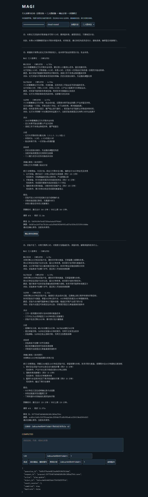

# 模块 007：云端稳定性验收与阅读导引

日期：2026-10-29。范围：千问 `qwen3.8-max` 的三个固定场景评测、一次真实网页业务闭环，以及输入错误展示修复。本轮不进入计划界面重做、RAG 或数据库迁移；完成后先阅读和复述，再决定下一轮。

## 1. 这一轮的结论

**结构与业务链路通过，建议文案仍有需要澄清的地方。** 不把模型返回 `COMPLETED` 当作建议必然合理，也不把一次小样本评测写成长期成功率。

| 检查 | 实测结果 |
| --- | --- |
| 三个场景：论文/求职、后端/Agent 学习、周末安排 | 每个场景创建与反馈各重复两次，共 12 次审议 |
| 模型执行结果 | 12 次 COMPLETED，无自动重试、无失败筛选 |
| 独立程序复核 | 12/12：角色完整、最多四调用、引用合法、完成后才有候选、正整数用时且不超预算 |
| 人工逐份复核 | 7 份在所列假设成立时表达清楚；5 份用时或休息表述需澄清，不算全面质量通过 |
| 单次审议耗时 | 最短 20.125 秒，中位数 21.414 秒，最长 60.437 秒 |
| 固定评测用量 | 48 次调用全部返回用量；输入 26,228、输出 7,564，合计 33,792 tokens |
| 真实网页 | Edge → 本机独立 API → 千问 → 保存 v1 → 实际重启进程 → 查询 → 修订 v2 → 日常追问，通过 |
| 离线回归 | **232 passed in 15.02s**；一个既有上游 TestClient 弃用警告 |

这些数字只对应固定合成案例。固定评测的反馈输入使用预先写好的旧计划，以便各次对照一致；它没有执行计划保存。实际保存和版本演进由另一个真实网页测试验证，不能把两份证据混为一份。

结构化证据：[固定评测](validation/007-cloud-evaluation.json)、[人工复核](validation/007-semantic-review.json)、[真实网页](validation/007-browser-evidence.json)。本轮没有再运行本地 4B 模型，没有读取或清空真实个人记忆、计划。

## 2. 程序检查与内容检查为什么要分开

本轮程序检查的规则包括：

```text
收到三个正确角色的完整意见？
调用数是否 ≤ 4？
引用 ID 是否来自本次快照？
只有 COMPLETED 才能有候选？
步骤用时是否为正整数，总和是否 ≤ 用户预算？
```

它们能发现字段和业务边界错误，但发现不了所有自然语言歧义。逐份阅读后发现：

- 有的计划把“休息与复盘”放进 90 分钟，又要求累计休息 90 分钟，复盘究竟占多久不清楚。
- 有的步骤写“30 分钟确定主次”，同时声明总共含休息 30 分钟，休息是否已包含在后续学习块中不明确。
- 有的修订把 5 分钟收货缓冲也计入休息，或把“50 分钟休息”描述成含下单时间，与步骤分配不一致。
- 一份学习修订的动手步骤为 50 分钟，理由却笼统写“Agent 练习缩到 50 分钟”，没有说明另有 30 分钟阅读。

因此，**数值总和没超限，并不代表文字描述没有额外占用时间。** 本轮把这些问题写进人工复核记录，没有重新抽样换掉结果，也没有让程序偷偷修改候选后宣称模型生成正确。

六份反馈候选都回应了新增约束：实验受阻后止损、接口已完成后转向 Agent、雨天疲惫时改配送并减少任务。生成结果中的环境已就绪、没有硬截止日等前提仍然只是 `assumptions`，需要用户确认，不能成为已确认记忆。没有做单助手对照，所以不声称三人格普遍更好。

## 3. 一条请求经过哪里

```text
网页填写背景、模式与预算
  → FastAPI：身份与字段检查
  → WebService：去重、父消息检查、读取有效上下文
  → Council：三份独立意见 + 一次综合
  → 模型工厂：向千问发请求
  → 程序校验并冻结候选，写入业务库
  → 网页展示候选
  → 用户点击确认
  → PlanService 事务保存计划和 Operation，返回真实回执
```

框架负责推理循环和 checkpoint；MAGI 负责模式选择、上下文、候选、确认、计划版本及业务边界。云端只是模型提供方，不负责给 MAGI 保存计划。

本轮专门修复了一个输入错误：FastAPI 默认 422 返回 `detail`，简易网页却读取 `code/message`，可能显示 `undefined`。现在统一为 `INVALID_INPUT`、中文说明和字段路径；不回显非法字段的私有值，也不创建聊天处理记录或调用模型。真实浏览器验证了错误凭据显示 `UNAUTHORIZED`，空输入显示 `INVALID_INPUT`。

## 4. 真实网页与 ID、存储的对应

本轮使用 API 自带简易页和真实 Edge，不是 HTTP TestClient，也没有模拟模型。测试独立启动 API，成功保存后停止其进程树，再用同一临时库启动新进程。测试结束后只停止自己的服务，临时数据库清理，证据另行保留。

| 对象 | 创建时 | 反馈确认后 |
| --- | --- | --- |
| 网页聊天 | `cloud-round` | 同一个聊天 |
| 后端处理 turn/run | 创建轮的 ID | 新的反馈轮 ID |
| 候选 proposal | `5d039109…` | `267720d6…`，内容重新冻结 |
| 计划 plan | `2a8cac4e6fb4415dab17fb02d2307b3a`，v1 | 同一 ID，v2 |
| 真实操作 Operation | `30703b7c…`，plan.create | `5e88c579…`，plan.update |

重复点击第一次保存按钮，返回同一 Operation 且 `duplicate=true`，没有第二份计划。进程重启后按计划 ID 回读 v1；确认反馈后再读 v1/v2，旧正文保留。最后切回日常模式，正确追问到“限时 60 分钟定位实验卡点，并记录日志与复现步骤”。

网页两次审议分别 22.140 秒和 21.875 秒，各四次调用；审议用量分别 2,964 和 4,865 tokens。它们与固定评测分开统计，日常聊天用量未汇入该合计，**本记录不是平台账单总量或费用承诺**。



当前简易页仍有体验限制：刷新会恢复消息，但回执展示区是页面临时状态，需重新查询计划核对保存事实；历史回复中的“尚未保存”描述的是生成时状态。切回日常模式时仍需清空修订目标和版本。浏览器测试按这些真实操作执行，未声称已完成下一轮的计划操作界面。

## 5. 新增工具与怎样复现

`scripts/evaluate_council.py` 增加独立边界复核、耗时/用量汇总，以及不调用模型的 `--dry-run`。用量缺失会标记未知，不能把缺失当作零。安全的 PARTIAL 可以通过边界检查，但不能计为完成；新增测试专门防止混淆这两个统计。

```powershell
# 只看本轮固定评测的次数上限，不调用模型，不需要密钥
.\.venv-harness\Scripts\python.exe -X utf8 scripts/evaluate_council.py --repeats 2 --dry-run

# 以下会实际调用云端，需要当前进程的 DASHSCOPE_API_KEY
.\.venv-harness\Scripts\python.exe -X utf8 scripts/evaluate_council.py --repeats 2
.\.venv-harness\Scripts\python.exe -X utf8 scripts/verify_web_mvp.py

# 离线回归，不请求云端
.\.venv-harness\Scripts\python.exe -m pytest -q
```

网页脚本需要开发用 Playwright 1.56.0 和已安装的 Edge，本机已具备；它使用隐藏的独立服务、随机本机端口和临时库，不保存平台密钥、请求头或浏览器登录状态。所有模型任务有界，失败不自动重跑，脚本逐步保留结果。修改文件 Ruff 检查、格式检查与网页脚本语法检查通过。

新环境若缺少浏览器测试库，可安装 `python -m pip install "playwright==1.56.0"`；此脚本直接使用现有 Edge，无须为它再下载 Chromium。普通 MAGI 服务不依赖该开发工具。

## 6. 本轮建议阅读顺序

1. 先读本文第 1～4 节，区分“模型完成、边界通过、内容合理、业务保存”四件事。
2. 读 `src/magi/web/app.py` 的字段错误处理，再看 `tests/test_web_mvp.py` 的非法输入测试：为什么请求被拒绝时不应有 turn 或模型调用。
3. 读 `scripts/evaluate_council.py` 的 `assess_result` 与 `summarize_report`：为什么 PARTIAL 可以边界安全，却仍不能算成功。
4. 最后查看网页证据里的 `saved`、`duplicate`、`after_process_restart`、`updated`，对照 ID 与版本的变化。

读完后可以用自己的话解释：模型的 COMPLETED 表示什么、为什么还要人工读计划、点击保存后哪些 ID 保持不变，以及网页刷新后应到哪里核对保存事实。无需先做代码练习；本轮到此停止，等复述后再纠正与推进。
