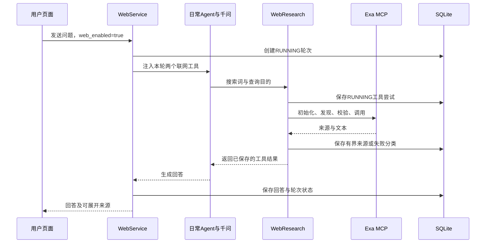

# 模块034：通过MCP联网查资料

日期：2026-11-03。范围：日常聊天按需搜索公开网页、读取网页片段、展示实际来源、保存并恢复本轮记录。用户原先考虑把计划写进笔记，随后明确选择联网查资料，因此本轮的外部能力是只读查询，没有增加笔记写入或任务管理平台。

## 1. 这轮解决什么问题

假设你正在学习Python后端，想知道：“Python 3.12的TaskGroup遇到子任务异常时会怎样？”原来的MAGI能读本地授权资料，也能调用千问，但没有工具去找外部最新资料。模型即使写出网址，也不能证明它访问过该页面。

现在可以在日常聊天输入框旁勾选“联网查资料”，要求先搜索再读取官方页面。模型决定是否调用工具，程序负责真正联系外部服务，并把返回的标题、网址和片段保存下来。回复下方的“本轮联网资料”来自这些实际工具记录，而不是从回答里猜出来的引用。刷新、重新连接并加载同一会话后，仍可查看当时收到的资料。

这个方向符合个人学习助手的用途，也能学习MCP、工具调用、超时、输入校验和数据库恢复。一轮同时交付后端、页面、真实调用和学习说明，不把协议框架与实际用途拆成多轮。它不替代原有本地RAG，也没有让三个角色各自联网；本轮仅给日常聊天增加可选择的能力。

**本轮真实样本跑通了功能链路，但回答内容没有通过完整人工复核。** 模型把不同版本的资料混在一起，并声称关键章节已经完整获取，实际保存片段并不支持这个说法。后文用这个失败解释为什么“接上工具”和“可靠回答”是两件事。

## 2. 如何使用

已有千问环境的用户，停止服务后安装可选联网依赖：

```powershell
.\.venv-harness\Scripts\python.exe -m pip install -r requirements-mcp.lock.txt
.\scripts\start_magi.ps1
```

这个锁文件包含原有千问环境的锁文件，再补入MCP SDK等依赖。正常启动仍使用原有配置、千问密钥和网页本机服务凭据。联网查询连接Exa官方托管MCP端点，当前实现使用匿名访问，没有把千问或硅基流动的密钥传给Exa。匿名服务受可用性和额度限制，不承诺永久免费或稳定服务。

连接网页后，保持“三人格分析：关闭”，勾选“联网查资料”，例如输入：“查Python 3.12官方TaskGroup文档，先搜索再读取，注明版本和来源；资料不足就说明。”回复下面展开来源，看搜索词、调用状态、时间、网址、片段和截断提示。开启联网表示允许本轮使用工具，并不强制模型每次都调用。

开关在页面中保持当前选择，直到手动关闭、切换三人格或刷新；每条发送请求会冻结当时的选择。切换三人格会取消勾选并禁用。当前终端界面没有新增联网开关；API日常聊天可传`web_enabled: true`。失败后重试原消息会读取原记录，不自动再次搜索；要重新查需要发送新消息。

查询词、查询目的和目标网址会发给Exa；检索片段会返回千问生成回答。本轮没有实现敏感信息自动识别与脱敏。提示词要求只传必要内容，但这不是程序级防泄漏证明。不要把不希望离开本机的内容放进联网查询。

## 3. 从页面到工具：谁负责哪一步

页面发送`TurnInput`，其中`web_enabled`默认关闭并严格要求布尔值。`WebService.turn`先检查请求身份、重复消息与会话顺序，建立一条业务轮次，再在开启联网时为本轮创建`WebResearch`。它将两个工具交给现有的日常Agent：`magi_web_search`和`magi_web_fetch`。

模型第一次返回工具名称和参数，相当于提出“请执行这个查询”，此时还没访问网页。现有框架执行对应Python函数，函数通过MCP联系Exa。模型收到实际工具结果后，可以再请求读取一个网页，最后生成回答。真实样本就是三次模型请求：提出搜索、提出读取、生成回答；外部工具调用两次。



成熟组件负责通用工作：Deep Agents和LangGraph负责模型与工具循环、历史checkpoint和已有调用限制；官方MCP Python SDK负责协议会话与传输；HTTPX负责HTTP连接；Pydantic与jsonschema负责参数形状校验；SQLite负责本机事务。

本项目新增的部分是业务适配：是否开放工具、固定允许哪些远端工具、查询预算、结果解析、来源持久化、错误分类与网页展示。Exa负责互联网检索与网页提取，本项目没有自己实现搜索引擎，也没有把MCP描述成提升模型准确率的算法。

## 4. MCP具体做了什么

MCP可以理解为应用和工具服务之间共同遵守的对话规则。客户端先建立会话，问服务“你提供什么工具，参数是什么”，再请求执行一个工具。本轮使用HTTP上的Streamable HTTP传输，不启动本地MCP子进程。

下面是`src/magi/web_research.py`中`mcp_call`的实际核心片段。省略外层函数、允许名单检查和HTTP客户端上下文；这些外层代码将端点固定为`https://mcp.exa.ai/mcp`，HTTP超时30秒，整个调用总期限40秒，并关闭HTTP自动重定向。

```python
async with ClientSession(read, write) as session:
    await session.initialize()
    catalog = await session.list_tools()
    tool = next((t for t in catalog.tools if t.name == name), None)
    if tool is None:
        raise ValueError("远端工具已变化")
    validate(arguments, tool.inputSchema)
    return await session.call_tool(name, arguments)
```

`name`由本地包装函数固定选择，只有`web_search_exa`与`web_fetch_exa`能进入这里；模型不能随意指定远端方法。`arguments`来自本轮问题或网址，加上程序固定的数量预算。`initialize`完成协议初始化；`list_tools`读取服务当下的工具目录；没有对应工具时拒绝继续，避免调用已变化的接口。`validate`按服务声明的JSON Schema检查参数，检查通过才`call_tool`，返回SDK的`CallToolResult`。

实际发现结果保存在[034-mcp-discovery.json](validation/034-mcp-discovery.json)。它揭示搜索需要`query`和`objective`，网页读取使用`urls`数组。接入依据实际发现而不是猜参数。每次调用都重新初始化和发现，简单但有额外往返；当前没有连接池与目录缓存。

发现工具不等于授权全部工具。程序没有把远端目录里的所有工具注册给模型，也不把远端描述当成系统指令。当前没有任意MCP服务器配置、OAuth、动态安装或多个服务管理；如果以后扩展，应另外设计授权和凭据隔离。

上游参考（2026-11-03核对）：[MCP Python SDK](https://github.com/modelcontextprotocol/python-sdk)、[Exa官方MCP项目](https://github.com/exa-labs/exa-mcp-server)。SDK锁定为1.30.0；服务端本身不受本地版本锁控制，因此解析失败要显式报告。

## 5. 如何限制一次联网查询

`WebResearch.tools`把两个本地函数包装成`StructuredTool`。搜索参数`query`是查询词，`objective`是要核对的目标，两者限制为非空、最多500字符，并拒绝多余字段。读取参数`url`最多2000字符。模型先经过工具参数校验，实际调用还经过程序检查和服务端Schema检查。参数合法只证明能按约定调用，不证明查询能找到正确内容。

`public_url`拒绝非HTTP网址、带用户名密码的网址、明显本机或内网地址以及非标准端口。它不在本机请求目标网页；实际抓取由Exa执行。它也不解析DNS，不能声称覆盖域名解析变化、重定向或所有服务端请求伪造场景。HTTPS公开页面是否可读仍取决于远端服务。

本轮限制如下，都是上限而非保证值：

| 项目 | 本地约定 | 对使用的影响 |
| --- | --- | --- |
| 联网调用 | 每轮最多3次，失败也消耗次数 | 防止反复搜索失控；框架总工具预算可能更早耗尽 |
| 搜索返回 | 最多3个来源，每个最多2000字符 | 方便模型阅读，但可能切掉关键解释 |
| 网页读取 | 每次1个网址，最多保留4000字符 | 不保证包含目标章节，更不等于全文 |
| 标题 | 最多300字符 | 展示长度可控 |
| 超时 | 每次完整MCP调用40秒 | 不是整轮模型生成40秒完成的承诺 |
| 自动重试 | 无 | 不静默增加匿名额度消耗，也不隐藏失败 |

`WebResearch.call(operation, target, objective)`由两个工具包装函数调用。`operation`是search或fetch；`target`在搜索时是查询词，在读取时是网址；`objective`仅用于搜索。它返回JSON字符串，供模型继续推理。成功、失败或格式异常都用明确状态表达。

下面摘录实际预算和尝试记录代码，重点看“发请求前已经记录一次尝试”：

```python
with self.lock:
    if len(self.records) >= 3:
        return json.dumps(
            dict(status="FAILED", error_code="CALL_BUDGET_EXCEEDED")
        )
    record = dict(
        id=f"web:{len(self.records) + 1}",
        operation=operation,
        target=target,
        objective=objective if operation == "search" else None,
        retrieved_at=datetime.now(timezone.utc).isoformat(),
        status="RUNNING",
        sources=[],
    )
    self.records.append(record)
    self.persist(self.records)
```

锁让同一轮的并行工具请求按顺序登记，避免两个请求同时抢到第三个名额。它是Python进程内锁，不是多实例分布式锁。已有WebService串行门仍限制本机业务并发，本轮没有改变单用户、单worker定位。

记录中的`retrieved_at`实际上是**尝试开始时间**，并非网页发布日期，也不是精确接收完成时间。第一次真实验收发生在增加`objective`持久字段之前，所以旧证据里没有这个字段；读取兼容旧记录，没有回填伪造历史。最终代码的新搜索记录会保存查询目的。

执行请求和结果保存之间的实际代码如下（中间参数构造已省略）：

```python
    result = asyncio.run(self.transport(name, args))
    record.update(normalize(result, operation, target))
except Exception as exc:
    record.update(status="FAILED", error_code=error_code(exc))
self.persist(self.records)
return json.dumps(record, ensure_ascii=False)
```

这里`transport`默认就是上面的异步MCP客户端；同步工具包装函数用`asyncio.run`执行它，适用于当前同步日常会话调用路径，并不是可在任意已运行事件循环中直接调用的通用异步接口。测试可注入替身传输来稳定制造超时，而真实验收使用默认传输。

`normalize`把远端结果变成固定来源结构；`error_code`将异常归为超时、认证、限流或连接协议失败等，不把上游异常正文或认证头显示给用户。SDK可能把异常装在任务组异常里，所以分类函数取其中第一项继续判断；这是简化分类，不是完整根因诊断。

## 6. 搜索摘录与网页片段怎样保存

搜索结果按实际Exa文本格式识别`Title:`和`URL:`，只保留前三个可解析且网址合规的块，不自行重排。每块截取前2000字符。读取网页要求返回以标题和URL开头的页面结构，避免将普通的“Access denied”错误文字当成正文。

`normalize`的读取分支先执行下面这段实际代码：

```python
header = re.match(r"# ([^\n]+)\nURL: (\S+)", text)
if not header:
    return dict(status="UNPARSED", error_code="UNRECOGNIZED_PAGE", sources=[])
try:
    returned_url = public_url(header[2])
except ValueError:
    return dict(status="UNPARSED", error_code="INVALID_SOURCE_URL", sources=[])
```

通过后保存远端返回的标题和网址，而不是凭模型请求的网址构造“已读页面”。返回字段`sources`含`title`、`url`、`excerpt`和`truncated`。`truncated=true`表示本地截取丢掉了后续字符；`false`也不证明完整，因为提供方可能已截断。当前先收完整SDK响应再做本地截取，没有流式限制远端响应总字节数，这是资源防护缺口。

状态区别需要结合例子理解：搜索没有任何文本是`NO_RESULTS`，只表示本次没返回内容；有文本但格式认不出是`UNPARSED`，可能是服务格式变化或错误页；服务标记错误或连接异常是`FAILED`；`OK`仅表示解析到来源片段。这些状态都不等于事实核验结论。

页面使用`textContent`显示片段，不执行网页里的HTML；来源链接单独创建且限制HTTP(S)。外部网页内容作为模型工具结果，仍可能包含诱导指令。提示词要求忽略这些指令，但本轮没有对抗攻击评测，不声称提示注入已被彻底解决。

## 7. 数据库在哪里变化，失败后留下什么

本轮复用`web_turns.result_json`，没有新建表或数据库迁移。聊天一开始仍按原机制写一条RUNNING轮次。每次工具调用之前、之后，业务层注入的`persist_web`各写一次来源数组。

下面是`src/magi/web/service.py`中`WebService.turn`内部回调的实际实现：

```python
def persist_web(records):
    """独立保存实际工具结果，后续模型失败仍能查询来源。"""
    with self.store.transaction() as db:
        db.execute(
            "UPDATE web_turns SET result_json=? WHERE id=?",
            (
                json.dumps(
                    {"web_research": records}, ensure_ascii=False
                ),
                turn_id,
            ),
        )
```

`records`由本轮WebResearch传入；`turn_id`在创建业务轮次时生成，回调捕获它，因此资料属于具体的一次聊天处理。事务在网络调用前或后快速提交，等待外部网络时不持有数据库写事务。这避免把慢网络等待变成长时间SQLite写锁。

正常情况下，第一次写入包含`web:1 / RUNNING`；收到搜索结果后替换为`web:1 / OK`并保存来源。读取页面前再追加`web:2 / RUNNING`，读取结束后保存它的结果。模型最后生成回答，业务层把回答、最终来源数组和COMPLETED状态写入这一轮。

如果搜索成功后模型失败，已经提交的来源仍在，原有异常处理只更新轮次失败状态和文本。恢复历史可以看见工具确实查到过什么。如果进程在网络请求中途退出，数据库里可能只留RUNNING工具尝试；服务恢复会把未完成的聊天轮次标为INTERRUPTED，但工具记录仍表示结果尚未确认，不凭空补成失败或成功，也不自动再请求外部服务。

如果第二次来源保存本身失败，不能声称返回资料已经持久化；异常会沿当前业务失败路径传播，之前提交的尝试仍可能保留。这里没有远端请求与本地数据库之间的原子事务，无法证明“外部执行恰好一次”。本轮是只读查询，采用保留不确定状态、不自动重跑的取舍。

### 各个ID分别代表什么

| 字段 | 对象与生命周期 | 不是哪一种ID |
| --- | --- | --- |
| chat_id | 用户选择的会话，如webcheck；跨多轮使用 | 不是一次网络请求 |
| message_id | 客户端一次提交，如u1；原请求重试保持不变 | 不是网页来源编号 |
| reply_message_id | 预留的回复身份，用于后续消息顺序 | 不是计划版本 |
| turn_id | 服务端创建的业务轮次，持久存入web_turns | 不是模型工具call_id |
| web:1、web:2 | 这一轮里的工具尝试编号；下一轮重新从1开始 | 不是全局引用编号或文档版本 |
| SDK/模型call_id | 框架匹配一次工具请求与结果 | 不能替代业务轮次与数据库保存事实 |

网络断开后，前端保留原请求体再提交，服务先按owner、chat和message查既有记录。摘要相同就返回原轮次，不再执行模型或联网；摘要不同拒绝复用该消息ID。这里复用了已有幂等机制。

新增字段还需要兼容升级前请求，`WebService.turn`实际执行：

```python
data = request.model_dump()
if not data["web_enabled"]:
    # 关闭时保持旧请求摘要，避免升级后旧回执不能重放。
    data.pop("web_enabled")
if request.web_enabled and mode != "chat":
    raise WebError("INVALID_INPUT", "联网查资料请使用日常聊天模式", 422)
signature = digest([data, mode])
```

关闭联网时不把新默认字段加入摘要，旧请求重放才能保持原身份；开启时将该字段计入摘要，避免把关闭联网的旧消息悄悄改成允许联网。三人格还没有同一轮共享联网证据设计，所以后端直接拒绝该组合，不只依赖页面禁用。

查资料只更新聊天轮次与框架对话记录，不调用计划保存或有效记忆写入。原有“自动提出记忆建议”是另一条功能，可在设置中关闭；它提出的候选也要用户确认。本轮没有把网页内容自动变成长期个人记忆。

## 8. 真实验证结果，以及它不能证明什么

离线测试使用替身模拟超时和返回文本，真实SQLite检验保存与重复提交。新增13项覆盖明显非法URL、预算、结果格式、片段长度、异常脱敏、模型成功或失败后的来源保存、请求重放及旧摘要兼容。最终完整回归为**445 passed，3 warnings，38.44秒**；警告来自已有依赖弃用，不是测试失败。命令与全部尝试见[034验收记录](validation/034-attempts.md)。

最初完整回归有一项失败：联网说明无条件加入所有会话，触发已有短上下文预算用例。修复是把`WEB_RESEARCH_PROMPT`只注入包含`magi_web_search`的会话，而不是提高测试预算掩盖问题。中断恢复后另一次受限环境运行卡住，文件仅有部分失败标记，没有完整诊断，不能算通过；保留原文件并另跑完整回归。

真实云端只生成一次，没有因为回答不好而挑选重试。脚本使用独立合成会话、关闭向量调用，并把生成上限设为1400，而生产配置原值为768。因此这次不能证明默认768预算下同样的长回答也会完成。真实调用经过千问、实际Agent循环、官方MCP SDK和Exa，不是仅手工调用一个HTTP接口。

原始[034-cloud-a.json](validation/034-cloud-a.json)记录一轮COMPLETED、搜索与读取各一次。另一个Python进程执行恢复读取，得到[034-restored.json](validation/034-restored.json)，历史与原报告逐字段相同。它证明这份已完成记录跨进程可读，不等于故障瞬间所有状态均通过真实杀进程演练。

浏览器使用真实Edge加载上述已存历史，检查来源展开、开关和三人格禁用、刷新重新连接后的来源恢复。它没有再发送新的付费模型请求，也没有模拟本轮网络丢回执。真实生成和浏览器展示是分开验证的，不能包装成浏览器端到端生成验收。

### TaskGroup这例暴露的内容缺口

搜索返回了Python 3.12.1页面、CPython主分支代码以及当前`/3/`文档。网址真实并不代表版本一致。搜索第一条截取到2000字符时，关键异常说明没有完整留下；随后读取的4000字符主要是页面开头，尚未到目标章节。模型却说关键异常处理描述已完整获取，这与落库片段不符。

回答还带入`GeneratorExit`特殊处理，并笼统写“CancelledError不传播”和“3.12.x系列行为一致”。本轮材料不足以支持这些泛化；特别是取消异常是否越过上下文边界需要区分取消来源和执行阶段，不能概括成永不传播。复核参考[Python 3.12官方Task Groups章节](https://docs.python.org/3.12/library/asyncio-task.html#task-groups)（2026-11-03），它与真实调用时收到的片段是不同取证步骤，不能倒过来补充模型当时的依据。

因此本轮交付的是可以查看实际依据的联网能力，**未通过该样本的完整语义支持检查**。没有实现版本过滤、章节定位、相关段落提取、重排或逐句引用核验。按用户先完成大功能模块的选择保留这些限制，不连续追加多轮提示词微调。实际使用时应打开原文核对关键结论。

最终解析器比真实调用时更严格：补上网页返回头检查，并保存实际返回标题；新记录还增加查询目的。这些调整有离线测试，旧真实返回的页面头也符合新解析格式，但没有再次调用千问做第二次完整真实生成。原始报告保留旧样貌，不伪装成最终代码重新生成的证据。

## 9. 面试知识关联：围绕项目说清楚

### 工具调用、MCP和Agent分别负责什么

业务问题是模型需要外部资料。基础知识是函数调用与远程协议分层：模型提出结构化参数，框架执行本地函数，MCP客户端与远端工具服务交换请求和结果。代码证据是`tools`、`call`和`mcp_call`这三层，而不是模型直接持有网络客户端。

取舍是复用官方SDK，只实现业务适配。可能追问“接MCP是否自动成为更聪明的Agent”：不能这样说。协议解决工具接入，Agent循环决定何时用工具，资料选择与内容推理仍可能错；真实TaskGroup例子就是反证。已验证两个实际工具，尚未验证任意服务兼容性。

### 为什么网络前后各保存一次，而不包在一个大事务中

业务问题是搜索发生过，但后续模型或进程可能失败。基础知识涉及短事务、失败窗口和分布式一致性。代码证据是`persist_web`的两次独立事务，网络等待在事务外。

取舍是先留下尝试，再保存可确认的结果。可能追问“这是否恰好执行一次”：不是。请求已到远端但本地未收到回执时仍有不确定性；本轮不自动重放，只显示未知结果。完成记录跨进程恢复已验证；真实网络中途崩溃、远端重试语义和多实例运行尚未验证。

### 为什么重复提交不能只靠按钮禁用

业务问题是服务已处理、浏览器却没收到响应。基础知识是幂等键、请求摘要和持久回执。代码证据是`WebService.turn`先查已有message，摘要一致直接读库；前端`pending`保存原请求，包括联网选择。

取舍是重试回到同一次业务提交，重新查询则发送新消息。可能追问“新字段为什么影响幂等”：把默认false加入旧摘要会改变原请求身份，所以关闭时排除它，开启时必须加入。离线集成测试验证重复提交只调用一次替身工具；本轮没有进行真实网络丢包实验。

### 为什么加了超时还需要调用预算

业务问题是模型可能反复搜索。基础知识是资源上限与分层超时：单次超时限制一回外部等待，调用预算限制累计次数，框架还限制模型与总工具次数。证据是40秒`asyncio.timeout`、3次`records`计数与已有Harness中间件。

取舍是失败也占额度，优先可控；没有自动重试。可能追问“是否一定120秒内完成”：不能，模型生成、数据库及其他工具还有各自时间。网络超时分类经过离线异常组测试，不是长期网络稳定性测量。

### 为什么引用存在仍不能证明回答可信

业务问题是有来源但版本和结论错了。基础知识是检索召回、证据覆盖与语义支持的区别。代码证据是`normalize`只解析和截取；它没有检查每句话是否被来源支持。

取舍是先提供可核对依据，不将可追溯性宣传为准确率提升。可能追问“下一步怎么改善”：可考虑版本约束、章节定位、相关段落提取与固定内容评测，但这些是扩展方案，不是本轮成果。没有虚构准确率、吞吐量或生产并发数字。

## 10. 建议阅读顺序与复述问题

先按第2节自己打开联网开关和来源，再读第3节调用过程。随后对照`web_research.py`看工具和MCP层，读第7节理解数据库边界，最后看真实失败和面试关联。不要先背全部状态与ID；先回答“用户看见了什么，程序真正做了什么”。

可以围绕以下问题检查理解，不要求逐段背诵：

1. 模型输出搜索工具参数时，网页已经被访问了吗？谁真正发出请求？
2. 搜索成功、回答失败，来源为什么还能恢复？如果结果写库前进程退出呢？
3. 为什么`web:1`不能当全局文档ID？为什么同一message重试不能修改联网开关？
4. 40秒超时、3次调用和4000字符分别控制什么？哪些事情不受它们保证？
5. TaskGroup样本有真实官方链接，为什么仍不能说回答通过验收？

本轮到此停下。后续是否改进内容质量或增加别的成熟Agent模块，等用户阅读后明确选择，不自动继续扩展。
